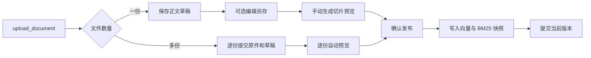
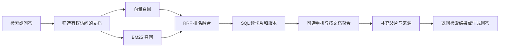

# RAG 代码流程与文件索引

本文按一次请求实际经过的顺序阅读。表中的文件路径相对于项目根目录，函数名可直接在 IDE 中搜索。接口参数示例见 [RAG模块功能与接口使用说明](RAG模块功能与接口使用说明.md)。

## 1. 请求如何进入 RAG

`app/core/application.py` 的 `create_application()` 为总路由挂载 `/api/v1` 前缀。`app/routers/router.py` 注册知识库、兼容入库、智能问答和简历路由。进入接口后，`app/core/dependencies.py` 的 `get_current_user()` 验证登录，`require_permission()` 根据 `app/core/permissions.py` 检查权限。路由读取请求并调用 Service，Service 编排业务，Repository 处理数据库查询，Adapter 负责访问存储、向量库或模型服务。

## 2. 知识库上传、预览和发布

入口 `POST /api/v1/knowledge/docs/upload`。一份文件先生成草稿，多份文件按同一分类逐份自动发布。

| 顺序 | 文件与函数 | 读代码时关注什么 |
|---|---|---|
| 1. 接收文件 | `app/routers/knowledge_router.py` → `upload_document()` | 读取 multipart 的 `file` 和共用 `category`。单份使用版本服务依赖，多份按文件循环并汇总结果。 |
| 2. 保存原件 | `app/services/knowledge_revision_service.py` → `upload()`、`artifact()`；`app/services/file_service.py` → `upload()` | 复用已有 `doc_id` 或新建文档。文件实体由存储适配器保存，`files` 表记录对象位置。外部写入前登记补偿日志。 |
| 3. 提取正文 | `app/ai/rag/document_loader.py` → `load()`；`app/ai/rag/ocr_service.py` → `recognize()` | PDF 逐页取文本，无文本页按配置 OCR。图片走本地 OCR，Excel 保留工作表和行号。解析后的正文和来源元数据保存为版本正文。 |
| 4. 保存或编辑版本 | `app/services/knowledge_revision_service.py` → `upload()`、`edit()`、`make_word()`；`app/repositories/knowledge_revision_repository.py` → `next_number()` | 初次上传生成草稿。编辑另存 Word 和新版本，后续使用新 `revision_id`。同一文档的版本编号由文档行锁串行分配。 |
| 5. 生成预览 | `app/routers/knowledge_router.py` → `preview()`；`app/services/knowledge_revision_service.py` → `preview()`；`app/ai/rag/document_splitter.py` → `split_for_index()` | 从正文生成可索引切片。分块入口按分类和配置选择策略，简历支持字段定位，分层切片可保存父片。预览保存切片快照和校验信息。 |
| 6. 检查发布条件 | `app/services/knowledge_revision_service.py` → `publish()`、`revision()`、`preview_fingerprint()` | 校验归属、`expected_version`、当前分块配置和预览对应的文档版本。过期预览需要重新生成。 |
| 7. 写入并生效 | `app/ai/rag/embedding_service.py` → `embed_texts()`；`app/adapters/vector_store/milvus_adapter.py` → `upsert()`；`app/ai/rag/bm25_index.py` → `search_index()` | 发布服务分配 SQL 切片 ID，按分类写 Milvus，保存索引清单及 BM25 快照，再提交生效版本。检索使用 SQL 当前切片 ID，隔离尚未生效的向量。 |
| 8. 收尾与补偿 | `app/routers/knowledge_router.py` → `get_revision_service()`、`recovery_lifespan()`；`app/services/rag_recovery.py` → `recover()`；`app/services/knowledge_revision_recovery.py` → `recover_revision_job()` | 事务失败回滚，外部资源由持久日志补偿。恢复任务核对当前切片后按精确 ID 清理，避免误删生效版本。 |

批量事务集中在 `KnowledgeRevisionService.upload_and_publish()`。每份文件先独立提交原件和正文，再执行预览及发布。解析失败可保留通过上传校验的原件，发布阶段失败可保留此前已保存的草稿。`batch_error()` 生成逐份失败原因，预览或发布阶段的错误还会返回 `stage`。持久任务的记录与锁管理位于 `app/repositories/rag_ingest_job.py` 的 `IngestJob`。

版本辅助操作同样从 `app/routers/knowledge_router.py` 进入。`list_revisions()` 查历史，`detail()` 读正文，`get_preview()` 调用服务的 `preview_detail()` 分页读快照，`restore()` 基于历史内容另存草稿，`discard()` 归档草稿，`download()` 根据 `source` 选择来源原件或版本文件。

## 3. 检索与智能问答

| 步骤 | 文件与函数 | 作用 |
|---|---|---|
| 检索入口 | `app/routers/knowledge_router.py` → `retrieve()`；`app/schemas/knowledge.py` → `RetrieveRequest` | 读取问题、分类、检索模式、阈值和结果粒度。 |
| 权限范围 | `app/ai/rag/retriever.py` → `Retriever.search()`；`app/repositories/knowledge_repository.py` → `accessible_docs()`、`active_chunk_keys()` | 从 MySQL 获取授权文档和当前切片，结合可选 `doc_id` 缩小范围。 |
| 向量召回 | `app/ai/rag/embedding_service.py` → `embed_query()`；`app/adapters/vector_store/milvus_adapter.py` → `search()`；`app/core/rag_constants.py` | 问题向量化，按分类映射集合并传入切片白名单。阈值筛选语义候选。 |
| 关键词召回 | `app/ai/rag/bm25_index.py` → `search_index()`；`app/ai/rag/lexical_search.py` → `tokenize()`、`bm25_rank()` | 快照复用分词语料，每次用当前问题重新评分。 |
| 排序与上下文 | `app/ai/rag/retriever.py` → `search()`、`_attach_parent_context()`；`app/adapters/llm/rerank_adapter.py` → `rerank()` | 融合排名、回表读原文、可选重排。文档模式取每份文档的最佳候选。父片与简历定位来自当前发布版本的快照。 |
| 智能问答入口 | `app/routers/text2answer_router.py` → `answer()`；`app/services/response_answer_service.py` → `handle()` | 续聊读取本人历史并改写追问，调用混合检索，拼接参考材料和来源。 |
| 模型与历史 | `app/adapters/llm/LLM_adapter.py`；`app/ai/core/llm_manager.py`；`app/services/memory_service.py` | 统一模型门面生成回答，消息与引用落库。`text2answer_router.py` 的 `conversations()`、`messages()` 提供本人历史查询。 |

`result_unit=auto` 在指定简历分类且未指定 `doc_id` 时按文档聚合，其他情况默认按切片返回。父片读取失败时仍返回已命中的子片。调试时可以先对比 `chunk_id` 和 `semantic_score`，问答的生成文本则看 `answer`。

## 4. 题库导入、同步与选题

| 步骤 | 文件与函数 | 作用 |
|---|---|---|
| 上传 JSON | `app/routers/knowledge_router.py` → `upload_question_bank()`，`POST /api/v1/knowledge/questions/upload` | 接收文件和 `sync_index`，校验管理权限。 |
| 校验与写库 | `app/services/question_bank_import_service.py` → `upload()`；`app/schemas/question_bank.py`；`app/repositories/question_bank_repository.py` → `upsert_import()` | 按题库契约校验整批，按 `bank_id` 和 `external_id` 幂等写入，提交后再同步向量。 |
| 生成索引 | `app/services/question_bank_index_service.py` → `sync()`、`_sync_batches()`、`question_index_text()`；`app/ai/rag/question_embeddings.py`；`app/adapters/vector_store/question_bank_adapter.py` | 命名锁控制同步并发。题干、选项等用于向量化，回写时校验内容版本，失败保存索引错误。 |
| 按配额选题 | `app/routers/knowledge_router.py` → `search_question_bank()`，`POST /api/v1/knowledge/questions/search`；`app/services/question_bank_service.py` → `search()` | 按可见题库、等级及题型配额选题，通过题目 ID 关联向量候选与数据库记录。 |

题库 JSON 示例在 `scripts/question_bank.example.json`。导入和选题直接使用上述 HTTP 入口。

## 5. 简历解析与兼容入库

简历流程从 `app/routers/resume_router.py` 进入。`upload()` 调用 `app/services/resume_service.py` 的 `upload()` 保存原件与记录。`parse()` 调用 `request_parse()` 并调度 `run_parse()`，后者用独立会话调用 `parse_worker()`。解析任务读取原件，经 `document_loader.py` 提取文字，再调用 `app/ai/workflows/resume_workflow.py` 的 `run_resume_workflow()` 生成结构化内容。`app/schemas/resume.py` 定义 `ParsedResume`，`app/repositories/resume_repository.py` 保存结果。客户端通过 `result()` 轮询，按需通过 `bind()` 绑定已有档案。

兼容入口集中在 `app/routers/rag_router.py`。`trigger()` 调用 `app/services/ingestion_service.py` 的 `process_document()`，核对文件 ID 和存储对象后复用 `app/services/knowledge_service.py` 入库。`embed()` 只生成查询向量，`fetch()` 在授权范围内读取 SQL 切片，`delete()` 调用 `delete_document()` 受理逻辑删除并登记补偿。旧文件上传地址由 `app/routers/a_rag_router.py` 转发给知识库的 `upload_document()`。
