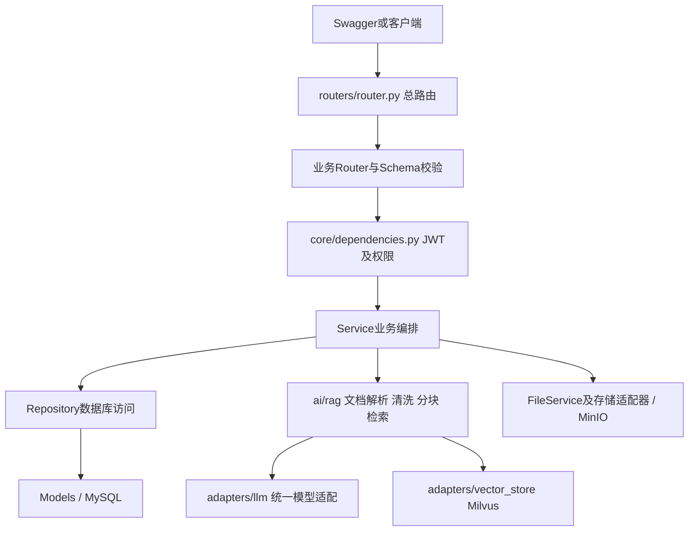
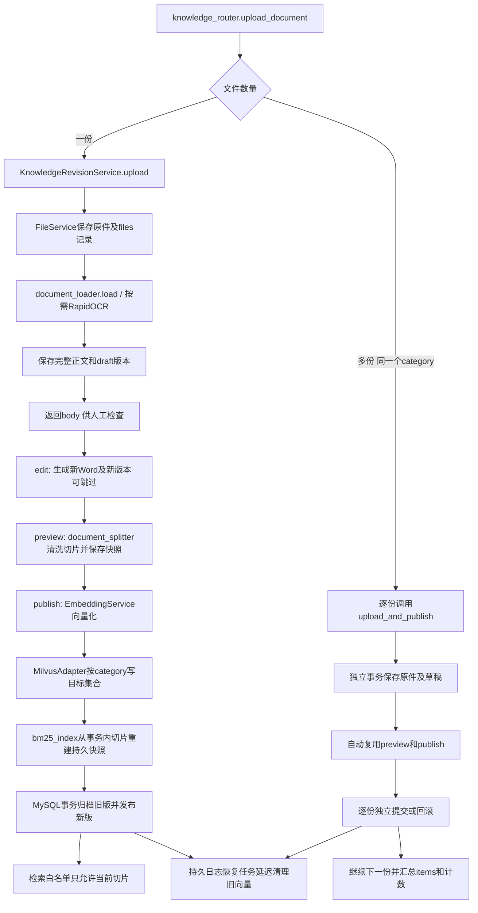
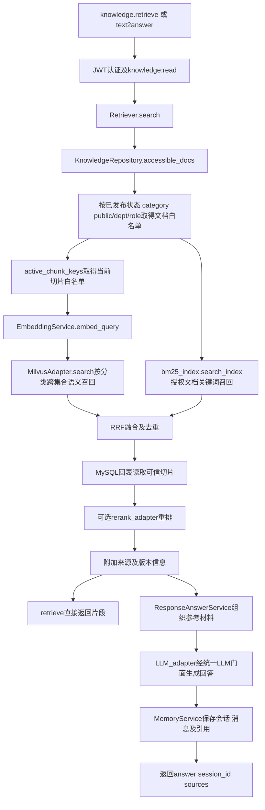
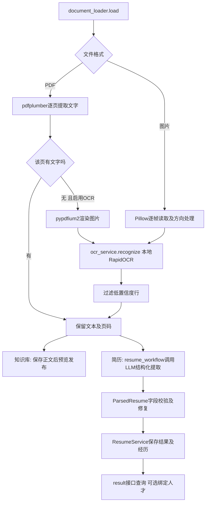

# RAG模块功能、接口使用与代码流转

更新时间：2026-11-05。本文对应当前代码，覆盖知识库、文档版本、批量上传、兼容入库、智能问答和简历解析；平台其他同学负责的岗位管理、测评等模块不在本清单中。所有路径默认加 `/api/v1`，Swagger地址为 `http://127.0.0.1:8000/docs`。

## 1. 已实现功能

| 功能 | 当前行为 |
|---|---|
| 单份上传 | 保存原件并解析完整正文为草稿，手动预览、编辑和确认发布 |
| 多份上传 | 同接口选择多份文件，整批共用一个必填分类，逐份自动处理及发布，分别返回成功/失败 |
| 文档版本 | 每次正文编辑生成新的Word和版本，保留来源关系；历史恢复也先生成新草稿 |
| 预览与并发 | 完整正文预览、分页切片预览、乐观锁及预览失效检查 |
| 格式解析 | TXT/MD、PDF、DOCX、XLSX、PNG/JPG/JPEG/BMP/TIF/TIFF；旧DOC/XLS须先转换 |
| 扫描及图片OCR | 本地RapidOCR；扫描PDF按页识别，保留页码；图片逐帧识别 |
| 清洗与切片 | 复用统一清洗和分块实现，支持重叠切片及配置选择语义分块 |
| 分类存储 | MinIO保存文件和快照；MySQL保存元数据、版本、当前切片；七分类映射三个Milvus集合 |
| 检索 | 语义、中文BM25及混合检索；RRF融合；可选模型重排 |
| 权限隔离 | JWT认证、角色操作权限、文档public/dept/role过滤、版本归属校验 |
| 发布补偿 | 先准备向量和BM25，再事务切换当前版本；持久化日志负责失败资源补偿和旧向量延迟清理 |
| 智能问答 | 基于授权片段生成回答，返回来源及版本引用，支持多轮追问、历史消息和会话标题 |
| 简历解析 | 原件上传、后台结构化提取、结果校验与查询、绑定已有档案 |

OCR提取文字，不承诺复杂版式、表格或手写内容还原；PDF某页已有可提取文字时，不额外识别该页内其他图片文字。单份上传不是自动发布；批量上传内部仍生成版本与预览快照，但不要求人工确认。

### 七分类和集合

| category | 中文类型 | Milvus集合（配置默认名称） |
|---|---|---|
| resume | 人才简历 | talent_chunks |
| job_description | 岗位说明 | knowledge_chunks |
| policy | 人才制度 | knowledge_chunks |
| training | 培训课件 | knowledge_chunks |
| assessment | 测评标准 | assessment_chunks |
| case | 历史项目案例 | knowledge_chunks |
| development_plan | 人才培养方案 | knowledge_chunks |

整批只能传一个category；程序不自动检查每份文件的内容是否符合所选类别。检索时category可省略，表示查找用户有权访问的各分类。

## 2. 接口公共约定

先通过平台 `POST /api/v1/auth/login` 获取access_token，在Swagger右上角Authorize填入。业务接口需要Bearer认证，普通JSON响应形如：

```json
{"code":200,"message":"success","data":{},"trace_id":"用于定位日志的请求标识"}
```

文件下载返回文件二进制。HTTP200不总是代表所有业务成功，批量检查failed_count，历史入库检查status。HTTP202表示已受理，需继续查询处理状态。

| 标识 | 含义 |
|---|---|
| doc_id | 稳定的知识文档ID，更新同一文档时复用 |
| revision_id | 某条版本记录的ID，填在版本接口路径中 |
| revision_no | 文档的业务版本序号 |
| version | 该记录的乐观锁号；请求expected_version使用最近响应值 |
| file_id | MySQL files表主键，不是MinIO对象名或doc_id |
| chunk_count | 切片数量 |
| session_id | 智能问答会话ID，续聊时传回 |

知识检索和问答需要 `knowledge:read`；知识管理需要 `knowledge:manage`，还须符合文档归属。以下清单中的“管理”均指此校验。全局分页使用page、page_size；版本和切片预览使用offset、limit。

## 3. 知识库接口：knowledge_router.py

以下路径均以 `/api/v1/knowledge` 开头，统一出现在Swagger“知识库”。

| 方法 | 子路径 | 功能和用法 | 权限 |
|---|---|---|---|
| POST | /docs/upload | multipart上传，file可重复多次；category必填；title可选默认文件名；doc_id可选。单份返回草稿详情，多份返回逐份自动发布结果 | 管理 |
| GET | /docs | 查询可管理文档；可传category、page、page_size，包括草稿；普通用户查本人，admin/超级用户可管理全部 | 管理 |
| GET | /docs/{doc_id}/revisions | 版本列表；offset默认0，limit默认50、最大100，返回items和total | 管理及归属 |
| GET | /revisions/{revision_id} | 查看完整body、状态、文件ID、来源版本和当前version | 管理及归属 |
| GET | /docs/{doc_id}/editable | 仅传doc_id，返回当前已发布生效版本的正文用于编辑页回显 | 管理及归属 |
| POST | /docs/{doc_id}/edit | **推荐**：仅传doc_id + body（title/category可选），后端以生效版本为基线另存新草稿 | 管理及归属 |
| POST | /revisions/{revision_id}/edit | 已废弃（deprecated）；旧写法，需传expected_version，新代码不要再用 | 管理及归属 |
| POST | /revisions/{revision_id}/preview | JSON传expected_version，生成切片快照；返回chunks、chunk_count及递增后的version | 管理及归属 |
| GET | /revisions/{revision_id}/preview | 查看保存的预览；offset默认0，limit默认50、最大200；检查preview_current和base_document_current | 管理及归属 |
| POST | /revisions/{revision_id}/publish | JSON传预览响应的version作为expected_version；同步发布，成功status=published | 管理及归属 |
| POST | /revisions/{revision_id}/restore | JSON传expected_version，按指定历史正文生成新的Word及草稿，仍需预览、发布 | 管理及归属 |
| POST | /revisions/{revision_id}/discard | JSON传expected_version，归档未发布草稿；已发布版本不能直接取消 | 管理及归属 |
| GET | /revisions/{revision_id}/file | source=false下载版本文件，source=true下载保留的来源原件 | 管理及归属 |
| POST | /retrieve | 检索切片，不生成答案；支持mode、category、top_k、use_rerank、score_threshold | 读取 |
| POST | /docs/{doc_id}/retry | 重试旧流程失败文档；无请求体。草稿不适用，版本流程失败应重新预览、发布 | 管理及归属 |

### 3.1 Swagger单份上传完整示例

1. 执行POST /knowledge/docs/upload，选择一个文件，category选training；初次上传doc_id留空。
2. 从data保存doc_id、revision_id、version，查看body。
3. 如需编辑，调用该revision_id的edit，例如：

```json
{"expected_version":1,"title":"培训报销制度","category":"training","body":"员工培训报销上限为3000元，须提交发票。"}
```

4. 编辑后使用响应中的**新revision_id**，调用preview：

```json
{"expected_version":1}
```

5. 检查chunks，使用预览返回的version调用publish，例如：

```json
{"expected_version":2}
```

6. GET版本详情确认published，再执行retrieve验证。上述1、2只是示例数字，必须使用自己的最新响应值。

例如revision_id=10、version=2，发布URL是 `/api/v1/knowledge/revisions/10/publish`，请求体是 `{"expected_version":2}`，不能把2填进路径。

### 3.2 多份上传

同一个上传接口在file选择多份文件，category只选一个，Execute后等待逐份完成。所有文件均按这个分类存取。

```json
{
  "total":2,"success_count":1,"failed_count":1,"category":"training",
  "items":[
    {"file_name":"培训A.txt","doc_id":100,"revision_id":201,"status":"published","chunk_count":3},
    {"file_name":"培训B.pdf","status":"failed","error":"文档解析失败"}
  ]
}
```

每份独立提交，失败不会撤销前面成功文件，也不阻止后续文件。通过上传校验的原件解析失败时，保留原件及失败版本；向量化或发布失败时保留已提交的草稿，结果附revision_status=draft及相关ID，可读取详情、修正后再预览发布。空文件、超限或不支持格式可能没有文档/版本ID。

不填doc_id时各文件独立新建文档；填写doc_id时各文件顺序追加到同一文档，最后成功发布的版本生效，之前成功版本归档。没有增加批量禁止更新的限制。title省略时各文件使用自己的文件名，填写时整批共用该标题。

### 3.3 检索示例

```json
{"question":"培训报销上限是多少？","category":"training","mode":"hybrid","top_k":5,"use_rerank":true,"score_threshold":-1}
```

mode支持hybrid（默认，语义+BM25）、semantic（仅语义）、keyword（仅BM25）；top_k为1～25。score_threshold为-1～1，仅作用于语义召回。返回切片原文、标题、doc_id、file_id、chunk_id、page、得分及revision_id/revision_no。重排需要对应模型与服务配置可用。

## 4. 兼容入库与切片接口：rag_router.py

路径前缀 `/api/v1/ingestion`，Swagger仍归“知识库”。这些是兼容与内部联调入口，通常先使用第3节的统一上传流程。

| 方法和子路径 | 功能、参数及用法 | 权限 |
|---|---|---|
| POST /trigger | JSON传file_id（数字字符串）、bucket_name、object_name、file_name、category；校验记录后读取已有原件直接入库，检查返回status | 管理及文件归属 |
| POST /embed_query | JSON传text，返回text、embedding和实际dim；只生成向量，不检索、不写Milvus | 读取 |
| POST /delete | JSON传file_id（数字字符串）、category；返回202，先逻辑删除文档，恢复任务延迟清理向量，不物理删除原件 | 管理及文档归属 |
| GET /chunks/fetch | category必填，file_id可选；offset默认0，limit默认100、最大1000；返回授权范围的当前切片items及total | 读取 |

触发已有原件入库示例（ID、对象名必须来自实际文件元数据，不要照抄）：

```json
{"file_id":"86","bucket_name":"ai-talent","object_name":"实际对象键","file_name":"培训制度.txt","category":"training"}
```

生成问题向量：`{"text":"培训报销上限是多少？"}`。受理删除：`{"file_id":"86","category":"training"}`。切片查看示例：`GET /api/v1/ingestion/chunks/fetch?category=training&file_id=86&offset=0&limit=20`。page_number=0表示缺少可靠页码。

旧 `POST /api/v1/files/upload` 保留为隐藏兼容地址，复用第3节上传函数及单份/多份规则，Swagger不重复展示。

## 5. 智能问答接口：text2answer_router.py

这三个接口需要knowledge:read；会话与消息仅当前用户本人可访问。

| 方法和完整路径 | 功能及用法 |
|---|---|
| POST /api/v1/text2answer | 首次传question，可选category、top_k（1～10）、use_rerank；续聊传回session_id。固定使用混合检索，返回answer、session_id、intent及sources |
| GET /api/v1/conversations | page/page_size分页查询本人会话，返回标题、消息数及最后消息时间 |
| GET /api/v1/conversations/{session_id}/messages | 查询本人消息及引用；limit默认100、最大200；before_id可翻查更早消息 |

首问示例：

```json
{"question":"培训报销上限是多少？","category":"training","top_k":5,"use_rerank":false}
```

续聊示例，session_id替换为首问响应值：

```json
{"question":"需要提交什么材料？","session_id":"123","category":"training","top_k":5,"use_rerank":false}
```

LLM通过统一适配器读取当前供应商、模型和密钥配置，支持DeepSeek；并非在问答代码中写死模型。无相关材料时返回资料不足提示。该接口不替代实时数据库统计问数。

## 6. 简历接口：resume_router.py

路径前缀 `/api/v1/resumes`。这里的结构化简历解析与knowledge中的resume分类是两个业务入口：上传简历不会自动进入RAG知识库。

| 方法和子路径 | 功能和用法 | 权限 |
|---|---|---|
| POST /upload | multipart单文件file，保存原件及简历记录；返回id、file_id、status、duplicate，之后另调parse | resume:upload |
| GET 空路径 | 列表；page/page_size，keyword、status、talent_id可选；普通用户只查本人，管理员可查全部 | resume:upload及范围 |
| GET /{resume_id} | 简历元数据详情，不是结构化结果 | resume:upload及归属 |
| POST /{resume_id}/parse | JSON为 `{"force":false}`，force=true强制重解析；返回202受理 | resume:parse及归属 |
| GET /{resume_id}/result | 轮询status，成功后查看parsed；失败看error及warnings，accuracy可能为空 | resume:upload及归属 |
| POST /{resume_id}/bind | JSON为 `{"talent_id":123}`，绑定已存在档案；不自动创建人才或覆盖主档字段 | resume:parse及管理范围 |

顺序：上传→记下返回id作为resume_id→parse→轮询result→成功后按需bind。后台任务为进程内任务，不是持久化任务队列，重启中断时须检查状态并重试。

## 7. 代码流转图

### 7.1 整体分层



### 7.2 单份与批量上传



### 7.3 权限、混合检索与问答



问答续聊先读取本人历史，并可调用模型把追问改写成独立检索问题，然后再走图中检索链。问答的短期缓存失败不会撤销已经提交的长期消息。

### 7.4 OCR及结构化简历



## 8. 关键代码位置

以下路径以项目根目录为起点，便于在IDE内搜索；详细版本文档见[文档版本接口使用与流转](文档版本接口使用与流转.md)。

| 文件 | 作用 |
|---|---|
| app/routers/router.py | 总路由注册 |
| app/routers/knowledge_router.py | 13个知识库入口，含单份/多份上传及所有版本操作 |
| app/services/knowledge_revision_service.py | upload、upload_and_publish、edit、preview、publish、restore及discard |
| app/repositories/knowledge_revision_repository.py | 版本查询、行锁及版本号分配 |
| app/models/knowledge_revision.py | 新增版本表，关联原文档、文件、发布人和来源版本 |
| app/services/file_service.py | 文件大小/格式校验，复用存储并登记files |
| app/ai/rag/document_loader.py | 多格式正文提取、扫描PDF/图片入口 |
| app/ai/rag/ocr_service.py | 本地OCR及置信度过滤 |
| app/ai/rag/document_splitter.py | 清洗、重叠分块及语义分块 |
| app/ai/rag/embedding_service.py | 文档和问题共用向量化服务 |
| app/core/rag_constants.py | 七分类到三个集合的统一映射 |
| app/adapters/vector_store/milvus_adapter.py | 向量写入、白名单检索、精确切片删除 |
| app/ai/rag/retriever.py | 权限先行、双路召回、RRF融合、重排及版本引用 |
| app/ai/rag/bm25_index.py / lexical_search.py | 持久语料快照及中文BM25评分 |
| app/adapters/llm/rerank_adapter.py | 可选模型重排 |
| app/routers/rag_router.py / services/ingestion_service.py | 4个兼容入库、删除、向量及切片接口 |
| app/routers/text2answer_router.py / services/response_answer_service.py | 3个问答与历史入口，以及问答编排 |
| app/services/memory_service.py | 本人会话、消息及短期记忆 |
| app/adapters/llm/LLM_adapter.py / deepseek_adapter.py | 复用统一LLM门面和DeepSeek适配器 |
| app/routers/resume_router.py / services/resume_service.py | 6个简历接口、后台解析与绑定 |
| app/ai/workflows/resume_workflow.py / schemas/resume.py | 简历结构化提取与输出校验 |
| app/core/dependencies.py / permissions.py | 登录用户、角色权限及接口校验 |
| app/repositories/knowledge_repository.py | 文档访问范围、当前切片及可信原文回表 |
| app/repositories/rag_ingest_job.py | MinIO持久补偿日志及MySQL命名锁 |
| app/services/rag_recovery.py / knowledge_revision_recovery.py | 核实事务结果并补偿对象、暂存/历史向量 |
| app/config/settings.py | 环境配置，密钥不写入本文 |

## 9. 使用边界与常见问题

- 401：先登录并重新填入有效access_token。403：检查角色操作权限和文档归属。
- 404“文档版本不存在”：检查revision_id，不要填doc_id、revision_no或version。
- 409“版本已被修改”：先GET详情，以最新version作为expected_version；编辑后改用新revision_id。
- 409预览失效：正文/分块配置变化或其他版本先发布，须重新预览后确认。
- 无检索结果：检查是否已发布、分类、权限、切片状态及检索参数。
- 上传时未提供设置permission_scope、allowed_roles、organization_id的表单项；检索过滤读取文档现有权限字段，不能把选择category当作权限配置。
- 发布失败后先读取详情确认状态；旧发布版保持可检索。补偿worker需启用RAG_DURABLE_INGEST_ENABLED，或执行python -m scripts.recover_rag_jobs。
- 旧向量至少延迟60秒，worker每60秒扫描，不能把HTTP成功解释为远程旧向量已立即物理删除。
- 旧自动入库文档首次接入版本管理时，首版正文从旧切片重建，可能含重叠；来源原件仍可下载。
- 本轮离线回归115项通过，包含批量接口、事务隔离及配置/适配器检查；不代表所有真实服务场景均完成验收。新增批量远程联调和扫描件识别效果仍需按实际文档验证。

## 10. 建议验收顺序

1. 单份TXT上传→查看body→编辑另存→预览→发布→混合检索。
2. 两份同分类文件批量上传→检查逐份published及计数→检索各自内容。
3. 一份坏文件加一份正常文件→检查失败明细与正常文件发布结果。
4. 单份扫描PDF或图片上传→检查OCR正文→修正后发布。
5. 调用text2answer首问和续聊→检查sources→查询本人消息历史。
6. 上传简历→触发parse→轮询result→按需绑定已有talent_id。
7. 使用不同权限用户验证401/403及文档、会话隔离。
