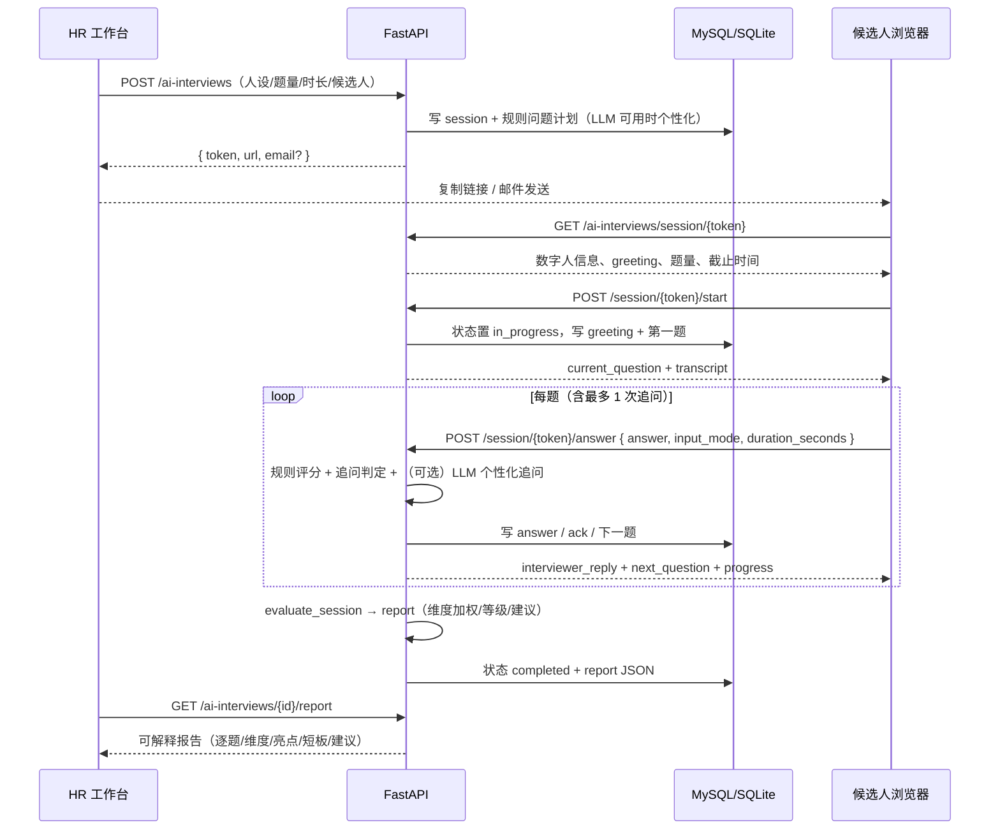

# AI 数字人面试 · 设计与使用说明

> 归属：`[Agent组]` · 新增于 2026-11-10
> 代码位置：`app/services/ai_interview_engine.py`（规则引擎）、`app/services/ai_interview_service.py`（流程编排）、
> `app/routers/ai_interview_router.py`、`frontend/src/pages/AIInterviewsPage.tsx`、`AIInterviewSessionPage.tsx`

## 1. 能力概览

AI 数字人面试在现有平台之上补齐「首轮结构化面试」环节，形成
**创建面试 → 候选人凭链接进入 → 数字人提问/追问 → 语音或文字作答 → 自动评分 → HR 查看报告** 的完整闭环。

- **HR 侧**：创建面试任务、选择数字人人设、配置题量/时长/难度/语言、复制候选人链接、查看进度与评估报告、取消面试。
- **候选人侧**：无需登录，凭一次性 token 打开 `/ai-interview/{token}`；数字人语音播报问题，支持浏览器语音识别转写或纯文字作答；倒计时结束自动提交。
- **可解释评分**：规则量化（完整度 / 结构 / 证据 / 岗位相关度 / 深度）+ 维度加权；LLM 仅用于个性化出题与报告措辞润色，异常时自动降级为规则结果，评分链路不依赖外部模型。

设计原则：

1. **不重建既有面试资产**：AI 面试使用独立表 `ai_interview_sessions` / `ai_interview_turns`，不改动测评模块的 `InterviewSession`；
2. **复用平台公共层**：统一响应、分页、异常、RBAC 权限、Repository、LLM 适配器、邮件通知、请求级事务；
3. **候选人零依赖**：不要求安装 App、不依赖第三方语音云服务；语音识别在浏览器内完成，服务端只保存文本；
4. **AI 不替代人工**：报告明确标注「AI 辅助参考」，低完成率时强制给出「样本不足」。

## 2. 数据模型

### 2.1 `ai_interview_sessions`（面试会话）

| 字段组 | 关键字段 | 说明 |
| --- | --- | --- |
| 关联 | `talent_id` / `position_id` / `invitation_id` / `assessment_id` | 均可空；从人才档案创建时自动带出姓名、邮箱、岗位 |
| 候选人 | `candidate_name` / `candidate_email` / `position_title` | 手工录入或人才快照 |
| 数字人 | `interviewer_persona` / `interviewer_name` / `interviewer_title` / `interviewer_style` / `avatar_theme` / `voice_hint` | 创建时按人设快照，避免后续调整人设影响历史面试 |
| 配置 | `language` / `difficulty` / `question_count` / `duration_minutes` / `expires_at` | 题量 3–10、时长 5–120 分钟、链接有效期 1–720 小时 |
| 状态 | `status` / `current_index` / `current_question_kind` / `follow_up_used` / `answered_count` | `pending → in_progress → completed`，另有 `cancelled` / `expired` |
| 结果 | `total_score` / `level` / `recommendation` / `report` / `plan` | `report` 为 JSON，含逐题评分、维度分、亮点/短板/建议 |
| 安全 | `token`（唯一索引）/ `started_at` / `finished_at` | token 由 `generate_random_token` 生成，仅用于本次面试 |

### 2.2 `ai_interview_turns`（对话轮次）

`seq`（会话内递增）、`role`（interviewer / candidate）、`kind`（greeting / main / follow_up / ack / answer / closing）、
`question_index`、`dimension`、`content`、`input_mode`（voice / text）、`duration_seconds`、`score`、`signals`（JSON）、`feedback`。

### 2.3 生命周期

```
pending ──start──▶ in_progress ──answer 完成/超时/finish──▶ completed
   │                    │
   └──cancel────────────┴──▶ cancelled
   └──expires_at 到期──────▶ expired
```

- 截止时间 = `min(session.expires_at, started_at + duration_minutes)`，由服务端计算并下发给候选人；
- 每次提问最多 1 次追问，避免「无限追问」；
- 候选人刷新页面可凭 token 恢复进度，`transcript` 由服务端重建；
- 取消/过期后公开接口只返回状态，不再允许作答。

## 3. 数字人设定

内置 4 个可切换人设（`app/services/ai_interview_engine.py::PERSONAS`）：

| key | 姓名 | 定位 | 风格 | 主题色 | 语言/音色倾向 |
| --- | --- | --- | --- | --- | --- |
| `friendly_hr` | 晓岚 | 资深招聘官 | warm | aurora 蓝紫 | 中文 / 女声 |
| `tech_lead` | 陈拓 | 技术负责人 | professional | cyan 青蓝 | 中文 / 男声 |
| `strict_expert` | 沈砚 | 首席面试专家 | rigorous | violet 紫粉 | 中文 / 男声 |
| `global_interviewer` | Ava | Global Talent Partner | global | amber 金橙 | English / 女声 |

前端 `components/ai/DigitalHuman.tsx` 使用**纯 SVG + CSS** 绘制数字人（发型、耳机、麦克风、胸牌、眨眼、口型、声波、光环粒子），
不依赖图片与 3D 资源，离线可用、无肖像权风险；`state` 支持 `idle / speaking / listening / thinking / done`，
并尊重 `prefers-reduced-motion`。

## 4. 端到端流程



## 5. 评分方法（可解释优先）

### 5.1 维度与权重

| 维度 | 中文 | 权重 | 主要信号 |
| --- | --- | --- | --- |
| `professional` | 专业能力 | 1.30 | 关键点命中、技术细节、数字/指标 |
| `problem_solving` | 问题解决 | 1.20 | 结构标记（首先/其次/最后、STAR）、因果链 |
| `communication` | 沟通表达 | 1.00 | 长度、结构、清晰度、跑题惩罚 |
| `culture_fit` | 协作与文化 | 1.00 | 团队/协作/复盘/冲突处理相关表达 |
| `potential` | 成长潜力 | 0.80 | 学习、规划、反思、主动性表达 |

### 5.2 单题分数

```
score = 34
      + 长度分（0–20）
      + min(18, 切题度 * 1.6 * 18)
      + 结构分（0–10，每个结构词 4 分）
      + 证据/数字分（0–8，每个数字 3 分；含「三个月 / 两成 / 二十亿」等中文数字）
      + 深度分（0–6）
      - 跑题惩罚（长文本但相关度 < 0.06 时 −8）
```

满分 96（刻意留出余量：堆砌关键词、只背模板也拿不到 100）。

- 中文 <10 / <25 / <45 字，分别封顶 35 / 52 / 68；英文 <6 / <15 / <30 词同理，避免「一句话高分」；
- 相关度 = 关键点覆盖率 45% + 题干/回答 overlap coefficient 35% + 维度词典覆盖率 20%；
  对篇幅足够（中文 ≥60 字 / 英文 ≥40 词）的实质回答设 0.28 的切题基线，避免候选人因未逐字命中关键词而被系统性判为跑题；
  该基线写入 `signals.relevance_floor`，报告可核对；
- 未作答题目在报告中保留 `score = null`，不按 0 分拉低其他维度。

### 5.3 追问策略

满足任一条件才追问（每题最多 1 次）：

- 回答过短（中文 < 50 字 / 英文 < 20 词）；
- 缺少关键点或没有具体例子/数字；
- 分数处于中间区间且仍有可挖细节。

高分且信息充分时直接进入下一题，避免「好答案也被反复盘问」。

### 5.4 报告与等级

- 完成率 < 50% → 等级「样本不足」，建议「需补面或人工复核」，不输出「暂不推荐」等硬结论；
- 总分 ≥90 卓越 / ≥80 优秀 / ≥70 良好 / ≥60 合格 / 其余待提升；
- 建议：≥85 强烈推荐、≥75 推荐、≥65 可考虑、其余暂不推荐；
- 报告含 `summary`、`strengths`、`weaknesses[{dimension,label,score,gap}]`、`suggestions`、`per_question`、
  `signals`（命中关键词/数字/字数）、`integrity`（作答时长、语音/文字占比等）与 `scoring_method`。
- `scoring_method` 形如 `rule` 或 `rule+llm:<model>`，明确区分是否经过大模型润色。

## 6. 接口契约

统一前缀 `/api/v1`，响应均为 `{ code, message, data, trace_id }`。

### 6.1 HR 侧（需登录 + 权限）

| 方法 | 路径 | 权限 | 说明 |
| --- | --- | --- | --- |
| GET | `/ai-interviews/config` | `ai_interview:read` | 人设列表、默认题量/时长/有效期、语言与难度选项 |
| GET | `/ai-interviews` | `ai_interview:read` | 分页列表；支持 `status` / `keyword` / `talent_id` / `position_id` |
| POST | `/ai-interviews` | `ai_interview:manage` | 创建面试；返回 `token`、`url`、`plan_source`、`email` 发送结果 |
| GET | `/ai-interviews/{id}` | `ai_interview:read` | 详情：配置 + 问题计划 + 对话记录 + 报告 |
| GET | `/ai-interviews/{id}/report` | `ai_interview:read` | 仅报告；未完成返回冲突 |
| POST | `/ai-interviews/{id}/cancel` | `ai_interview:manage` | 取消（已完成/已取消幂等） |

### 6.2 候选人公开接口（凭 token，无登录）

| 方法 | 路径 | 说明 |
| --- | --- | --- |
| GET | `/ai-interviews/session/{token}` | 面试状态、数字人、greeting、当前问题、进度、剩余秒数、对话记录 |
| POST | `/ai-interviews/session/{token}/start` | 开始面试（幂等；已完成直接返回结果） |
| POST | `/ai-interviews/session/{token}/answer` | 提交回答 `{answer(1-4000), duration_seconds, input_mode}`；返回追问/下一题/进度/结果 |
| POST | `/ai-interviews/session/{token}/repeat` | 重读当前问题（数字人重播） |
| POST | `/ai-interviews/session/{token}/finish` | 提前结束；已答内容照常评估 |

> 路由顺序：`/config` 必须注册在 `/{session_id}` 之前，否则 FastAPI 会把 `config` 当成整数 ID 返回 422（已处理）。

### 6.3 权限矩阵

| 角色 | `ai_interview:read` | `ai_interview:manage` |
| --- | --- | --- |
| `super_admin` | ✅ | ✅ |
| `admin` | ✅ | ✅ |
| `hr` | ✅ | ✅ |
| `manager` | ✅ | ❌ |
| `employee` | ❌（403 / `code=2004`） | ❌ |

## 7. 前端页面

| 页面 | 路由 | 说明 |
| --- | --- | --- |
| HR 面试管理 | `/ai-interviews` | 指标条 + 状态/关键词筛选 + 面试列表；创建抽屉（候选人来源、数字人人设卡片、数字人预览、题量/时长/难度/语言/邮件）；创建成功弹窗复制链接；详情抽屉含「评估报告 / 对话记录 / 问题计划」三标签、雷达图、维度条、逐题复盘、导出 JSON |
| 候选人面试页 | `/ai-interview/:token` | 公开路由，无 `AppLayout`；落地页（数字人 + 须知 + 麦克风测试 + 语音播报开关）→ 面试页（倒计时、对话流、当前问题、语音/文字作答、重听、提前结束）→ 完成页（得分、维度、亮点、建议、隐私说明） |
| 侧边菜单 | 「人才发展 → AI 数字人面试」 | 受 `ai_interview:read` 控制，EMPLOYEE 不可见 |

语音能力说明：

- TTS 使用 `window.speechSynthesis`，按语言与 `voice_hint` 选择系统音色；播放前自动停止收音，避免回声；
- STT 使用 `SpeechRecognition` / `webkitSpeechRecognition`（Chrome / Edge 支持最好），`continuous + interimResults`；
- 不支持时自动降级为文字作答，并给出明确提示；
- 候选人页不会上传原始音频，仅提交转写文本；录音权限仅在点击麦克风时申请。

## 8. 配置项

```env
# AI 数字人面试（见 app/config/settings.py）
AI_INTERVIEW_DEFAULT_QUESTION_COUNT=6
AI_INTERVIEW_MAX_QUESTION_COUNT=10
AI_INTERVIEW_DEFAULT_DURATION_MINUTES=30
AI_INTERVIEW_LINK_TTL_HOURS=72        # 面试链接有效期（小时）
AI_INTERVIEW_LLM_PLAN=true            # LLM 个性化出题（失败自动规则降级）
AI_INTERVIEW_LLM_FEEDBACK=true        # LLM 润色评语（分数仍由规则引擎给出）
AI_INTERVIEW_LLM_TIMEOUT_SECONDS=45
AI_INTERVIEW_ANSWER_MAX_CHARS=4000
```

候选人链接基址按优先级取 `INVITE_BASE_URL` → `FRONTEND_URL` → `PUBLIC_BASE_URL` → 请求 Host，最后回退相对路径
`/ai-interview/{token}`。**生产环境务必显式配置 `INVITE_BASE_URL`（或 `FRONTEND_URL`）**，否则邮件中的链接依赖请求 Host。

## 9. 安全与隐私

- **Token 即凭证**：32 位随机串、唯一索引；只暴露面试所需字段（不含内部评分权重、逐题信号、其他候选人信息）。
- **最小权限**：HR 接口强制 `require_permission`；公开接口不读取当前登录用户，也不受 JWT 影响。
- **不存原始音频**：语音识别在浏览器完成，服务端仅落库文本与作答方式；日志不打印候选人回答全文。
- **AI 辅助定位**：报告固定提示「最终以招聘团队人工复核为准」；候选人完成页也注明「不构成自动录用/拒绝决定」。
- **候选人结果脱敏**：公开接口只返回分数、维度、亮点与建议，不返回 `recommendation`（对 HR 的录用建议），并从 `summary` 中剥离推荐结论。
- **数据保留**：随会话表统一软删除/审计策略管理；企业可按自身合规要求清理。

## 10. 测试与验收

- `tests/test_ai_interview.py`（10 个用例）：
  - 引擎单测：中英文问题计划、评分边界/短答案封顶/跑题惩罚、追问阈值、等级与建议；
  - 服务集成：创建 → 开始 → 多题作答 → 自动收尾 → 报告结构；
  - 异常：过期/非法 token、重复开始幂等；
  - API：权限（EMPLOYEE 403、MANAGER 只读）、公开流程（start/answer/finish/report）；
  - 隐私：候选人结果不返回 HR 推荐结论，summary 改第二人称，建议中过滤招聘决策语句。
- 回归：`pytest tests/test_ai_interview.py tests/test_code_tags.py tests/test_orm_mapping.py tests/test_api_grouping.py tests/test_mysql_ddl_defaults.py tests/test_router_stubs.py`。
- 前端：`npm run build`（tsc + vite）通过；本地 `npm run dev` + 后端 SQLite 可完成端到端演示。

## 11. 已知边界与后续可扩展

- 当前评分以规则为主，语义深度有限；后续可接入 embedding 相似度或 LLM rubric 评分，但需保留规则兜底与可解释信号；
- 追问最多 1 次，复杂岗位可配置为 2 次并引入「必须覆盖的关键点」；
- 视频/数字人 3D 形象未接入，当前为 SVG 数字人 + 系统 TTS；如需口型同步可接 Web Avatar / 云渲染；
- 邮件发送依赖现有 SMTP 配置，未配置时创建接口仍成功，并返回 `email.ok=false` 与失败原因；
- 面试转写文本可进一步对接培训/测评模块，形成「面试—诊断—培养」闭环。
