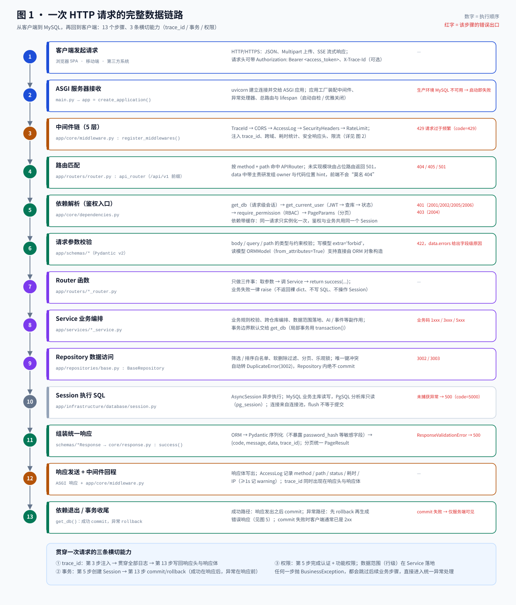
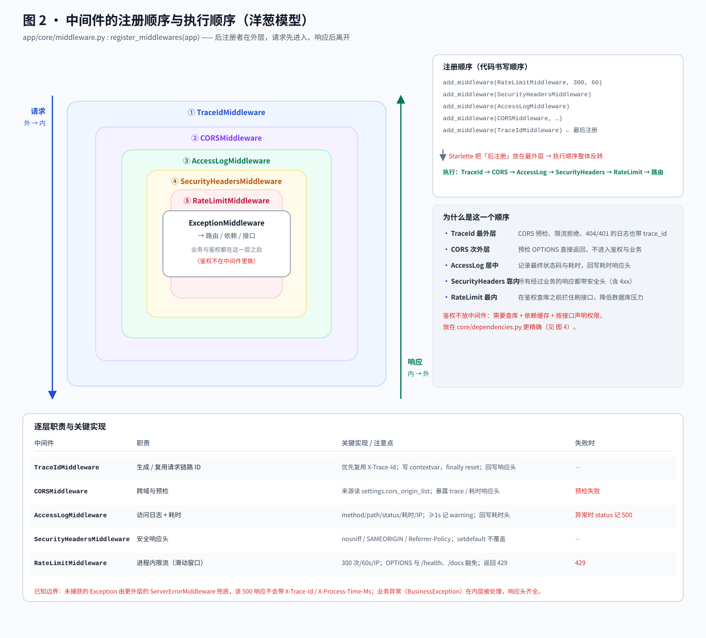
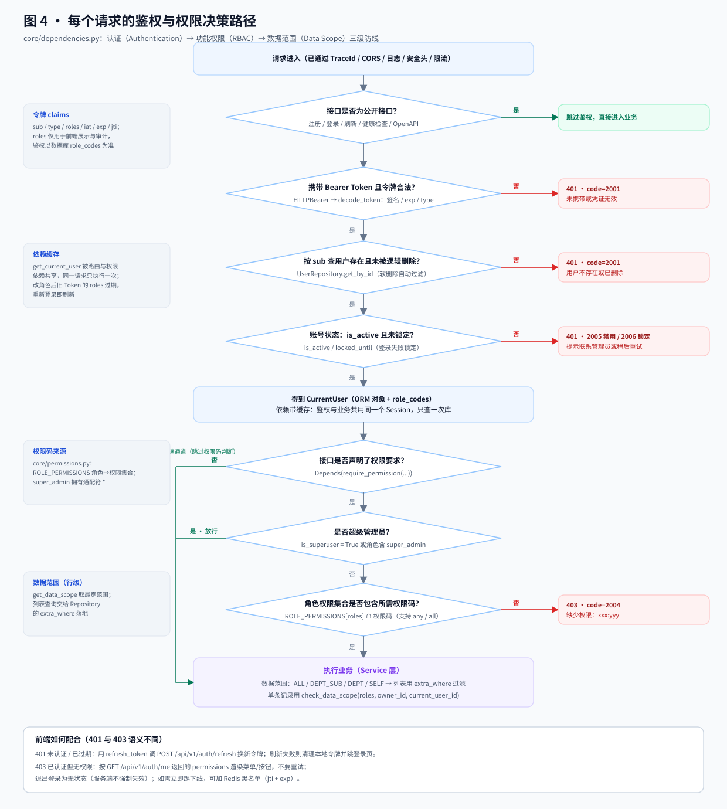
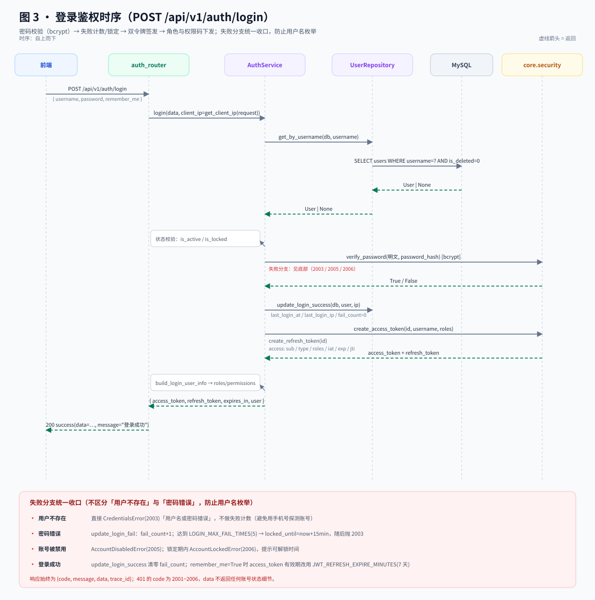
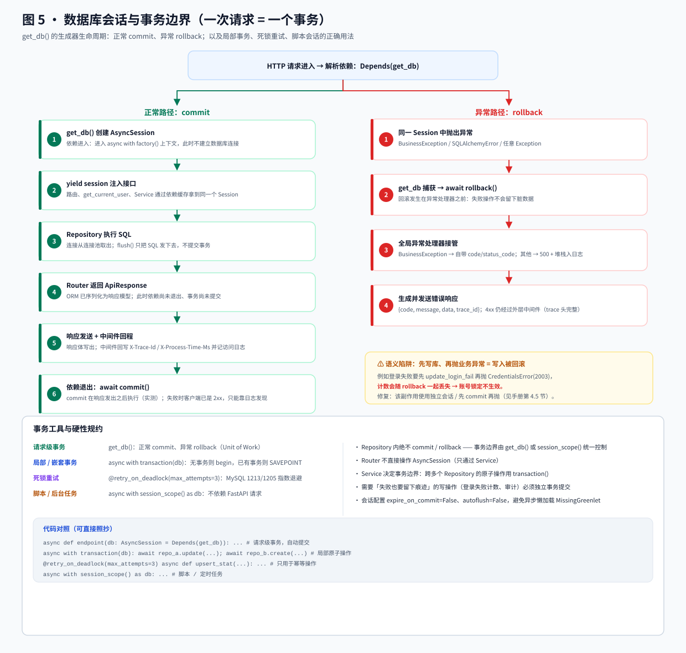
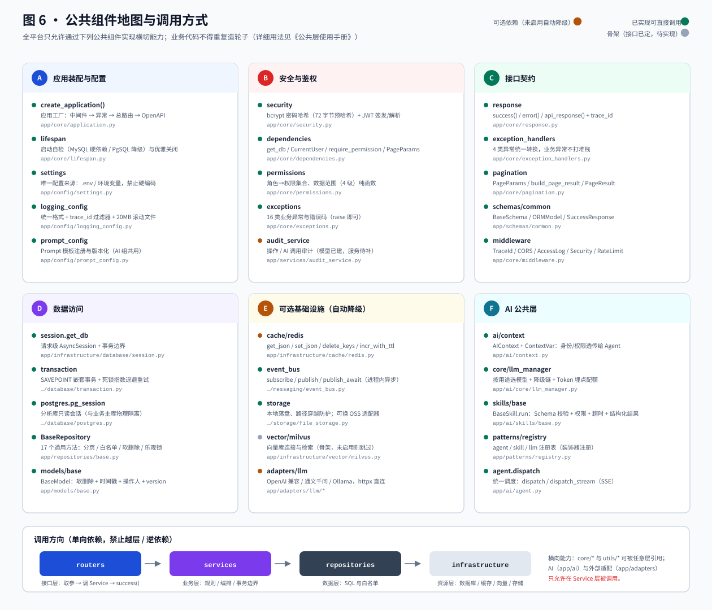
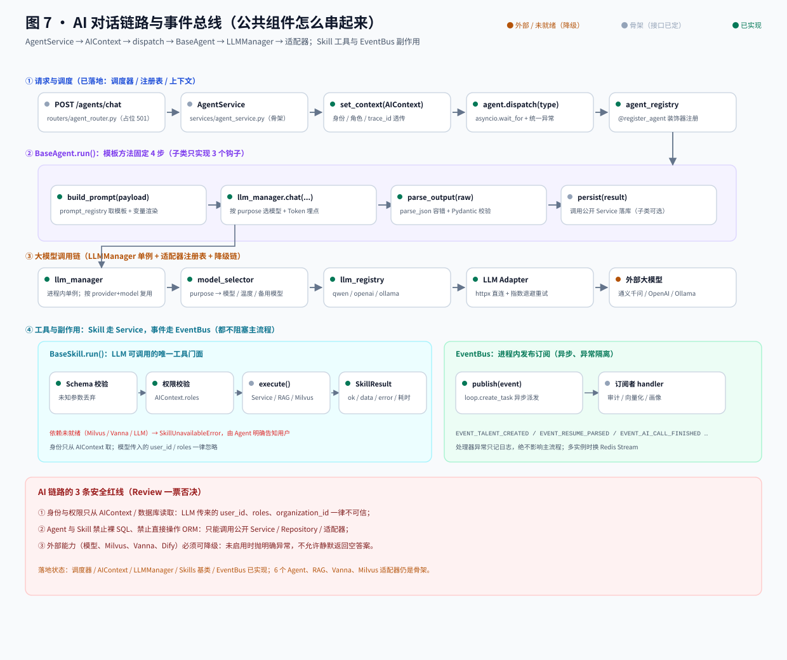

# AI 数字化人才平台 · 数据链路与鉴权实现手册

> **版本**：v1.0.0 ｜ **更新日期**：2026-11-04 ｜ **对应分支**：`arena/dcbfd09b-ai-talent-platform`
> **面向读者**：需要看懂「一次请求到底怎么走、怎么鉴权、怎么写库」的后端 / 前端 / 测试同学。
> **配套文档**：[公共层使用手册](公共层使用手册.md)（怎么写代码）、[系统总体设计](system_design_document.md)（设计取舍）、
> [架构说明](architecture.md)（六层架构）、[已实现功能清单](已实现功能清单.md)（哪些能用）。
>
> 本文所有结论都对应真实代码；关键行为已用 `TestClient` 实测（如中间件顺序、401/403/422/501 的真实响应）。

**流程图索引**（全部为内联 SVG，离线可看）：

| 图 | 主题 | 文件 |
| --- | --- | --- |
| 图 1 | 一次 HTTP 请求的完整数据链路（13 步） | [01-请求全链路.svg](diagrams/01-请求全链路.svg) |
| 图 2 | 中间件注册顺序与执行顺序（洋葱模型） | [02-中间件洋葱与执行顺序.svg](diagrams/02-中间件洋葱与执行顺序.svg) |
| 图 3 | 登录鉴权时序（密码 / 锁定 / 双令牌） | [03-登录鉴权时序.svg](diagrams/03-登录鉴权时序.svg) |
| 图 4 | 每个请求的鉴权与权限决策路径 | [04-请求鉴权与权限决策.svg](diagrams/04-请求鉴权与权限决策.svg) |
| 图 5 | 数据库会话与事务边界 | [05-事务与会话生命周期.svg](diagrams/05-事务与会话生命周期.svg) |
| 图 6 | 公共组件地图与调用方向 | [06-公共组件地图.svg](diagrams/06-公共组件地图.svg) |
| 图 7 | AI 对话链路与事件总线 | [07-AI与事件总线链路.svg](diagrams/07-AI与事件总线链路.svg) |

> 也可以直接打开单页版：[数据链路与鉴权流程图.html](数据链路与鉴权流程图.html)（内置全部 7 张图，无需联网）。

---

## 目录

1. [十句话看懂全链路](#1-十句话看懂全链路)
2. [全链路总览：一次请求的 13 步](#2-全链路总览一次请求的-13-步)
3. [中间件：怎么注册、怎么调用](#3-中间件怎么注册怎么调用)
4. [鉴权：从密码到数据范围](#4-鉴权从密码到数据范围)
5. [数据链路与事务边界](#5-数据链路与事务边界)
6. [响应 / 异常 / 分页的协作方式](#6-响应异常分页的协作方式)
7. [其他公共组件怎么用（速查）](#7-其他公共组件怎么用速查)
8. [新增一个受保护接口的完整模板](#8-新增一个受保护接口的完整模板)
9. [排障 FAQ](#9-排障-faq)
10. [附录：文件索引与调用树](#10-附录文件索引与调用树)

---

## 1. 十句话看懂全链路

1. **一次请求只走 5 层**：中间件 → 路由 → 依赖（鉴权）→ Service → Repository → `AsyncSession`。
2. **中间件只做横切**：trace_id、跨域、访问日志、安全响应头、限流；**不做鉴权、不写业务**。
3. **鉴权是依赖注入**：`Depends(get_current_user)` 解析 JWT 并查库，`Depends(require_permission(...))` 做 RBAC。
4. **权限以数据库为准**：鉴权用 `user.role_codes`（实时查库），Token 里的 `roles` 只用于前端展示与审计。
5. **一个请求 = 一个 Session = 一个事务**：正常结束 `commit`，任何异常 `rollback`。
6. **Router 只做三件事**：取参数 → 调 Service → `return success(...)`；失败一律 `raise`。
7. **Service 管业务**：规则校验、跨仓库编排、数据范围、事务边界；**Repository 管 SQL**：白名单、软删除、分页、乐观锁。
8. **响应结构唯一**：`{code, message, data, trace_id}`；异常由全局处理器统一转换。
9. **trace_id 三处一致**：响应头 `X-Trace-Id`、响应体 `trace_id`、日志的 `trace_id` 字段，同一条请求可 `grep` 串起来。
10. **可选依赖必须可降级**：MySQL 是硬依赖；PgSQL / Redis / Milvus / LLM 未启用或故障时，业务接口仍可用。

---

## 2. 全链路总览：一次请求的 13 步



### 2.1 十三个步骤对照表

| # | 阶段 | 代码入口 | 做什么 | 失败出口 |
| --- | --- | --- | --- | --- |
| 1 | 客户端发起请求 | 浏览器 / 移动端 / 第三方 | JSON、Multipart、SSE；可带 `Authorization`、`X-Trace-Id` | — |
| 2 | ASGI 服务器 | `main.py` → `create_application()` | uvicorn 收连接；装配中间件 / 异常 / 路由 / lifespan | 生产环境 MySQL 不可用 → 启动失败 |
| 3 | 中间件链 | `app/core/middleware.py` | TraceId → CORS → AccessLog → SecurityHeaders → RateLimit | 429 |
| 4 | 路由匹配 | `app/routers/router.py` | 按 method + path 命中；未实现模块返回 501 | 404 / 405 / 501 |
| 5 | 依赖解析（鉴权） | `app/core/dependencies.py` | `get_db` → `get_current_user` → `require_permission` → `PageParams` | 401（2001/2002/2005/2006）、403（2004） |
| 6 | 参数校验 | `app/schemas/*` | Pydantic v2 校验 body / query / path | 422（`data.errors`） |
| 7 | Router 函数 | `app/routers/*_router.py` | 取参 → 调 Service → `success()` | — |
| 8 | Service | `app/services/*_service.py` | 业务规则、编排、数据范围、副作用 | 业务码 1xxx / 3xxx / 5xxx |
| 9 | Repository | `app/repositories/base.py` | 白名单筛选/排序、软删除、分页、唯一冲突守卫 | 3002 / 3003 |
| 10 | Session → DB | `app/infrastructure/database/session.py` | `AsyncSession` 执行 SQL（MySQL 主库） | 未捕获异常 → 500 |
| 11 | 组装响应 | `schemas/*Response` → `core/response.py` | ORM → Pydantic → `{code,message,data,trace_id}` | 响应模型不匹配 → 500 |
| 12 | 响应发送 + 中间件回程 | ASGI 响应 / `app/core/middleware.py` | 响应体写出；AccessLog 记录状态与耗时；回写 `X-Trace-Id` / `X-Process-Time-Ms` | — |
| 13 | 依赖退出 / 事务收尾 | `get_db()` | 成功路径：响应发出后 `commit`；异常路径：先 `rollback` 再交给异常处理器 | commit 失败时客户端通常已收到 2xx，仅服务端日志可见 |

### 2.2 一次真实请求：没带 Token 的 `GET /api/v1/users`

```bash
curl -i http://127.0.0.1:8000/api/v1/users -H "X-Trace-Id: demo-001"
```

```http
HTTP/1.1 401 Unauthorized
x-trace-id: demo-001
x-process-time-ms: 1.9
x-content-type-options: nosniff
x-frame-options: SAMEORIGIN

{"code":2001,"message":"请先登录","data":null,"trace_id":"demo-001"}
```

同一时刻的服务端日志（`logs/app.log` 与控制台）：

```text
2026-11-04 07:16:33 | WARNING | demo-001 | app.core.exception_handlers | 业务异常 GET /api/v1/users -> code=2001 msg=请先登录
2026-11-04 07:16:33 | INFO    | demo-001 | app.access | GET /api/v1/users -> 401 | 1.9ms | ip=127.0.0.1
```

可以看到：

- 第 3 步生成的 `trace_id` 一路带到了日志、响应头、响应体；
- 第 5 步的 `get_current_user` 抛出 `AuthError("请先登录")`，被全局异常处理器转成 401 + `code=2001`；
- 依赖退出（第 13 步）因异常执行 `rollback`，且**异常路径的回滚发生在 401 响应生成之前**（本例没有写操作，等价于空事务）。

### 2.3 其他常见出口（实测）

| 场景 | 请求 | 响应 |
| --- | --- | --- |
| 参数校验失败 | `POST /api/v1/auth/register` body 只有 `{"username":"a"}` | `422`，`data.errors=[{field:"username",message:"String should have at least 4 characters"},{field:"password",message:"Field required"}]` |
| 接口不存在 | `GET /api/v1/not-exist` | `404`，`message="接口不存在"` |
| 模块未实现 | `GET /api/v1/talents` | `501`，`data={module, owner, hint}`（`owner` 为主责研发组） |
| 请求过于频繁 | 60 秒内同一 IP 超过 300 次 | `429`，统一响应结构 |
| 就绪探针 | `GET /health/ready`（MySQL 不可用） | `503`，`data.mysql.reason` 给出 `connection_refused` 等原因与修复建议 |

### 2.4 贯穿全链路的三条横切能力

| 能力 | 起点 | 落点 | 说明 |
| --- | --- | --- | --- |
| **trace_id** | 第 3 步 `TraceIdMiddleware` | 第 11 步写入响应体、第 12 步写入响应头 | 存 `ContextVar`，日志过滤器自动注入 |
| **事务** | 第 5 步 `get_db()` 创建 Session | 第 13 步 `commit` / `rollback` | 一个请求一个事务；成功路径的 commit 在响应发出之后，异常路径的 rollback 在错误响应之前 |
| **权限** | 第 5 步认证 + 功能权限 | 第 8 步 Service 内数据范围 | 认证 / 授权 / 行级范围三层防线 |

---

## 3. 中间件：怎么注册、怎么调用



### 3.1 注册代码

```python
# app/core/middleware.py
def register_middlewares(app: FastAPI) -> None:
    app.add_middleware(RateLimitMiddleware, limit=300, window_seconds=60)   # 1
    app.add_middleware(SecurityHeadersMiddleware)                          # 2
    app.add_middleware(AccessLogMiddleware)                                # 3
    app.add_middleware(CORSMiddleware, allow_origins=settings.cors_origin_list, ...)  # 4
    app.add_middleware(TraceIdMiddleware)                                  # 5（最后注册）
```

调用点只有一个：`app/core/application.py : create_application()` 里的 `register_middlewares(app)`，位于路由注册**之前**。中间件是应用级能力，不需要在每个 Router 上重复声明。

### 3.2 为什么「最后注册的最先执行」

Starlette 的 `add_middleware()` 把中间件插入 `app.user_middleware` 的**头部**，构建 ASGI 调用链时按该列表顺序包裹，因此：

```
注册顺序：RateLimit → SecurityHeaders → AccessLog → CORS → TraceId
执行顺序：TraceId → CORS → AccessLog → SecurityHeaders → RateLimit → ExceptionMiddleware → 路由
```

实测（`BaseHTTPMiddleware` 的 `dispatch` 进出日志）：

```text
in TraceId → in CORS → in AccessLog → in SecurityHeaders → in RateLimit
→ 路由 / 依赖 / 接口
out RateLimit → out SecurityHeaders → out AccessLog → out CORS → out TraceId
```

> 结论：**想让某个中间件「看到所有请求」（包括 CORS 预检、限流拒绝、404），就把它放在注册顺序的最后。**

### 3.3 逐层职责与关键实现

| 中间件 | 职责 | 关键实现 | 注意点 |
| --- | --- | --- | --- |
| `TraceIdMiddleware` | 为每个请求生成 / 复用链路 ID | 复用 `X-Trace-Id`，否则 `uuid4().hex[:16]`；写 `trace_id_ctx`、`request.state.trace_id`；回写响应头 | `finally` 中 `reset(token)`，避免协程间串号 |
| `CORSMiddleware` | 跨域与预检 | 来源来自 `settings.cors_origin_list`；暴露 `X-Trace-Id`、`X-Process-Time-Ms` | 生产必须配置具体来源（见 3.6） |
| `AccessLogMiddleware` | 访问日志 + 耗时 | 记录 method/path/status/耗时/IP；≥1000ms 记 `warning`；回写 `X-Process-Time-Ms` | 未捕获异常时 `response is None`，状态按 500 记录 |
| `SecurityHeadersMiddleware` | 安全响应头 | `X-Content-Type-Options` / `X-Frame-Options` / `Referrer-Policy` / `X-XSS-Protection`，全部 `setdefault` | `setdefault` 保证不覆盖业务自定义头 |
| `RateLimitMiddleware` | 进程内滑动窗口限流 | 300 次 / 60s / IP；`OPTIONS`、`/`、`/health`、`/health/ready`、`/docs`、`/redoc`、`/openapi.json` 豁免；超限返回统一 429 | 多 worker 不共享，生产换 Redis（见 3.6） |

### 3.4 trace_id 是怎么一穿到底的

```python
# app/core/middleware.py
trace_id = request.headers.get(TRACE_HEADER) or uuid.uuid4().hex[:16]
token = trace_id_ctx.set(trace_id)          # contextvars.ContextVar
request.state.trace_id = trace_id
try:
    response = await call_next(request)
finally:
    trace_id_ctx.reset(token)
response.headers[TRACE_HEADER] = trace_id
```

三个消费点：

1. **日志**：`logging_config.TraceIdFilter` 把 `trace_id_ctx.get()` 塞进每条 `LogRecord`，格式为 `时间 | 级别 | trace_id | 模块 | 消息`；
2. **响应头**：中间件回写 `X-Trace-Id`，前端报障时可直接提供；
3. **响应体**：`core/response.py` 的 `ApiResponse` 默认 `trace_id=trace_id_ctx.get()`，所以 `success()` 不需要手动传。

`ContextVar` 在协程之间自动隔离，但**不会自动跨线程 / 跨进程**。后台任务、线程池、消息队列消费如果要保留链路 ID，需要显式传入（例如 `AIContext(trace_id=...)`）。

### 3.5 怎么新增一个中间件

```python
from starlette.middleware.base import BaseHTTPMiddleware

class AuditMiddleware(BaseHTTPMiddleware):
    async def dispatch(self, request, call_next):
        response = await call_next(request)
        # 只做横切：不要在这里判断业务、不要查业务库
        return response

# app/core/middleware.py : register_middlewares()
app.add_middleware(AuditMiddleware)
```

选择插入位置的判断标准：

- 需要看到**所有**请求（含 CORS 预检、429、404）→ 注册在 `TraceIdMiddleware` 之后（即最外层之一）；
- 只关心进入业务的请求（如审计入库）→ 注册在 `RateLimitMiddleware` 之前（靠内层），避免给被限流的请求写审计；
- 需要读取 `request.state.user` → 不要做中间件，做**依赖**（用户对象由依赖注入产生）。

### 3.6 四个已知边界（不是 bug，但要知道）

1. **未捕获的 `Exception` 不带 trace 头**  
   Starlette 的 `ServerErrorMiddleware` 位于所有用户中间件之外；未捕获异常由它兜底，因此该 500 响应缺少 `X-Trace-Id` / `X-Process-Time-Ms`（业务异常 `BusinessException` 在内层被处理，头是齐全的）。  
   → 约定：业务可预期错误一律抛 `BusinessException` 子类；真正的兜底 500 排查靠服务端日志堆栈。

2. **限流是进程内实现**  
   `RateLimitMiddleware._hits` 是进程内字典，多 worker / 多实例下每个进程独立计数。生产环境应改为 Redis：
   ```python
   from app.infrastructure.cache.redis import incr_with_ttl
   count = await incr_with_ttl(f"rate:{ip}:{path}", ttl=60)
   if count > 300: ...
   ```

3. **CORS 通配符 + 凭证**  
   默认 `CORS_ORIGINS="*"` 且 `allow_credentials=True`。Starlette 在两者同时存在时会**回显请求的 Origin**，等价于允许任意站点携带凭证跨域访问。生产环境必须在 `.env` 中配置具体前端域名（逗号分隔）。

4. **`BaseHTTPMiddleware` 与流式响应**  
   SSE（Agent 对话）建议使用纯 ASGI 中间件或在路由层直接返回 `StreamingResponse`；`BaseHTTPMiddleware` 对客户端断连、后台任务的传播存在已知行为差异，长连接场景要单独压测。

### 3.7 为什么鉴权不放在中间件里

| 中间件鉴权 | 依赖注入鉴权（本项目） |
| --- | --- |
| 只能拿到 path，无法知道接口声明了什么权限 | 每个接口用 `Depends(require_permission(...))` 精确声明 |
| 需要自己维护「白名单路径」，容易漏 | `openapi_extra={"security": []}` 显式标注公开接口 |
| 无法复用 FastAPI 的依赖缓存（一次请求查多次库） | `get_current_user` 带缓存，鉴权与业务共享同一个 Session |
| 抛出的异常难以走统一错误码 | 直接 `raise AuthError` → 全局处理器转 401/403 |

---

## 4. 鉴权：从密码到数据范围



三层防线：

| 层 | 回答的问题 | 实现位置 | 失败码 |
| --- | --- | --- | --- |
| 认证 Authentication | 你是谁？令牌是否有效、账号是否可用 | `core/security.py` + `core/dependencies.py` | 2001 / 2002 / 2005 / 2006（HTTP 401） |
| 授权 Authorization | 你能做这个操作吗？ | `core/permissions.py` + `require_permission` | 2004（HTTP 403） |
| 数据范围 Data Scope | 你能看到哪些行？ | `core/permissions.py` 纯函数，Service 落地 | 2004（HTTP 403） |

### 4.1 密码：bcrypt + 72 字节预哈希

```python
# app/core/security.py
def hash_password(password: str) -> str: ...      # bcrypt.gensalt(rounds=BCRYPT_ROUNDS=12)
def verify_password(plain, hashed) -> bool: ...   # 失败/格式损坏一律返回 False
```

- bcrypt 只处理 72 字节，超长密码先做 `sha256` 预哈希（`_prehash`），避免抛异常；
- 数据里**永远不存明文**，也不存可逆加密；
- 哈希格式损坏时返回 `False`（不让脏数据把登录接口打成 500）。

### 4.2 令牌设计（JWT 双令牌）

| 令牌 | 有效期 | Claims | 用途 |
| --- | --- | --- | --- |
| `access_token` | `JWT_EXPIRE_MINUTES`（默认 1440 分钟 = 1 天）<br>`remember_me=True` 时用 `JWT_REFRESH_EXPIRE_MINUTES`（7 天） | `sub`、`type=access`、`iat`、`exp`、`jti`、`username`、`roles` | 每个业务请求的 `Authorization` |
| `refresh_token` | `JWT_REFRESH_EXPIRE_MINUTES`（默认 7 天） | `sub`、`type=refresh`、`iat`、`exp`、`jti` | 只用于换新的 `access_token` |

```python
access = create_access_token(user.id, username=user.username, roles=user.role_codes)
refresh = create_refresh_token(user.id)
payload = decode_token(token)                     # 校验签名、exp、required claims、type
```

- 算法与密钥来自 `settings.JWT_SECRET_KEY` / `JWT_ALGORITHM`，**禁止硬编码**；
- `decode_token` 区分「过期」（`TokenExpiredError` 2002）与「非法/类型不符」（`AuthError` 2001）；
- Token 中冗余 `roles` 的用途：前端渲染菜单、审计记录；**鉴权不依赖它**（见 4.4）。

### 4.3 登录时序与失败处理



代码路径：`routers/auth_router.py : login()` → `services/auth_service.py : AuthService.login()` → `UserRepository`。

| 分支 | 处理 | 返回 |
| --- | --- | --- |
| 用户不存在 | 直接抛 `CredentialsError`（**不累计失败次数**） | 401 / 2003 |
| 密码错误 | `update_login_fail`：`fail_count + 1`，达到 `LOGIN_MAX_FAIL_TIMES`(5) 设置 `locked_until = now + 15min`，再抛错 | 401 / 2003 |
| 账号禁用 | `AccountDisabledError` | 401 / 2005 |
| 锁定中 | `AccountLockedError`（提示可解锁时间） | 401 / 2006 |
| 成功 | `update_login_success`（`last_login_at` / `last_login_ip` / `fail_count=0`），签发双令牌 | 200 |

设计要点：

- **统一错误文案**「用户名或密码错误」，不区分用户是否存在，防止账号枚举；
- 登录失败次数与锁定字段落在 `users.fail_count` / `users.locked_until`，无需额外表；
- ⚠️ 登录失败计数存在一个事务陷阱，见 [5.5](#55-重要陷阱写库后抛异常导致回滚)。

### 4.4 每个请求的认证：`get_current_user`

```python
# app/core/dependencies.py
bearer_scheme = HTTPBearer(auto_error=False, description="Bearer <access_token>")

async def get_current_user(credentials, db) -> User:
    if credentials is None or not credentials.credentials:
        raise AuthError("请先登录")                       # 2001
    payload = decode_token(credentials.credentials)       # 2001 / 2002
    user_id = int(payload["sub"])
    user = await UserRepository().get_by_id(db, user_id)  # 复用请求级 Session
    if user is None or user.is_deleted:
        raise AuthError("用户不存在或已被删除")            # 2001
    if not user.is_active:
        raise AccountDisabledError()                      # 2005
    if user.is_locked:
        raise AccountLockedError()                        # 2006
    return user
```

四个容易忽略的点：

1. **`auto_error=False`**：没有 Token 时不让 FastAPI 抛默认的 403，而是走统一 `AuthError`（401 + code 2001）；
2. **只查一次库**：FastAPI 依赖默认 `use_cache=True`，同一请求里路由、`require_permission`、Service 拿到的是**同一个 `User` 与同一个 `Session`**；
3. **每次请求都读数据库**：角色 / 状态变更立即生效，不用等 Token 过期；代价是每请求一次主键查询（必要时可加 Redis 缓存 60s）；
4. **不信任 Token 里的 roles**：`require_permission` 使用 `user.role_codes`（来自数据库关系表），Token 的 `roles` 仅作展示。

### 4.5 功能权限（RBAC）

```python
@router.post(
    "",
    dependencies=[Depends(require_permission(PermissionEnum.TALENT_CREATE))],
)
async def create_talent(...): ...
```

- 单个权限：`require_permission("talent:read")`；
- 任一满足：`require_permission("talent:read", "talent:update")`（默认 any）；
- 全部满足：`require_permission("talent:read", "talent:update", require_all=True)`；
- 角色判断：`require_roles("hr", "admin")`；超管专用：`require_superuser`。

权限模型：

```text
用户 --(user_roles)--> 角色(code) --(ROLE_PERMISSIONS)--> 权限码集合 --(校验)--> 接口
```

| 角色 | 权限范围（摘要） | 默认数据范围 |
| --- | --- | --- |
| `super_admin` | `{"*"}` 通配符，全部通过 | ALL |
| `admin` | 用户 / 组织 / 人才 / 岗位 / 简历 / 测评 / 培训 / 匹配 / 知识库 / 分析 / 文件 / 审计 | ALL |
| `hr` | 人才、岗位、简历、测评、培训、匹配（读写），用户只读 | ALL |
| `manager` | 部门内只读为主（人才 / 岗位 / 测评 / 培训 / 匹配 / 分析 / 知识库） | DEPT_SUB |
| `employee` | 组织、岗位、培训、知识库只读 + Agent | SELF |

- 权限码规范 `模块:动作`，共 28 个（`core/permissions.py : PermissionEnum`）；
- `is_superuser=True` 直接放行（跳过权限码判断）；
- 失败抛 `PermissionDeniedError` → 403 / code 2004；
- 新增权限码：加进 `PermissionEnum` → 在 `ROLE_PERMISSIONS` 里分配给角色 → 路由使用。

### 4.6 数据范围（行级权限）

```python
from app.core.permissions import get_data_scope, check_data_scope, DataScopeEnum

scope = get_data_scope(user.role_codes)        # 多角色取最宽：ALL > DEPT_SUB > DEPT > SELF
```

| 范围 | 含义 | 列表查询落地方式（Service） | 单条数据落地方式 |
| --- | --- | --- | --- |
| `ALL` | 全部数据 | 不加条件 | 不校验 |
| `DEPT_SUB` | 本部门及下级 | `OrganizationRepository` 取子树 id，`extra_where=[Talent.organization_id.in_(ids)]` | 判断数据所属部门是否在子树内 |
| `DEPT` | 本部门 | `extra_where=[Talent.organization_id == user.organization_id]` | 同上 |
| `SELF` | 仅本人 | `extra_where=[Talent.created_by == user.id]` | `check_data_scope(..., owner_id=obj.created_by, current_user_id=user.id)` |

约定：**数据范围只在 Service 层翻译成查询条件**，Repository 只负责执行；Router 里不写任何范围判断。

### 4.7 刷新、退出与吊销

```text
POST /api/v1/auth/refresh   { "refresh_token": "..." }
  → decode_token(expected_type="refresh")
  → 查用户并校验状态（禁用 / 删除直接拒绝）
  → 重新签发 access_token（refresh_token 不轮转）
```

- **刷新不轮转**：返回新的 `access_token` + 原 `refresh_token`，实现简单；如需强安全可改为一次性 refresh（旧 token 立即失效，需配合 Redis）；
- **退出无状态**：`POST /auth/logout` 只返回成功，服务端不维护会话；前端丢弃令牌即可；
- **强制下线（扩展点）**：JWT 无状态导致无法立刻失效。可引入 Redis 黑名单：
  ```python
  # 登出时
  await redis.set(f"auth:bl:{jti}", "1", ex=exp - now)
  # get_current_user 解码后
  if await redis.exists(f"auth:bl:{payload['jti']}"):
      raise AuthError("登录已失效，请重新登录")
  ```

### 4.8 前端对接约定

1. `POST /api/v1/auth/login` → 保存 `access_token` / `refresh_token`；
2. 之后所有请求：`Authorization: Bearer <access_token>`；
3. 401（`code` 为 2001/2002）→ 调 `/auth/refresh`；失败则清理令牌并跳登录；
4. **并发刷新要做单飞（single-flight）**：多个请求同时 401 时只发起一次 refresh，其余等待结果，避免刷新风暴；
5. `GET /api/v1/auth/me` 返回 `roles` 与 `permissions`，用于渲染菜单与按钮（前端隐藏 ≠ 后端放行，后端必须再校验）；
6. 403（2004）不要重试，提示「无权限」即可；
7. Swagger 调试：先调 `/auth/login`，复制 `access_token`，点右上角 **Authorize** 粘贴（`persistAuthorization=true`，刷新页面不丢）。

### 4.9 安全清单（Review 用）

- [ ] 密钥来自环境变量，生产环境已替换默认 `JWT_SECRET_KEY`
- [ ] `CORS_ORIGINS` 配置了具体域名，没有用 `*` 配 `allow_credentials`
- [ ] 新增接口要么声明权限依赖，要么显式标注 `openapi_extra={"security": []}`
- [ ] 响应 Schema 不含 `password_hash`、身份证、完整手机号等敏感字段（日志用 `mask_sensitive`）
- [ ] 列表接口落地了数据范围（不能只靠前端隐藏）
- [ ] 修改密码 / 重置密码后提示重新登录（当前实现不会让旧 Token 立即失效）
- [ ] 登录、导入、导出等敏感操作有审计记录（`audit_logs`，见 7.5）

---

## 5. 数据链路与事务边界



### 5.1 `get_db()` 的生命周期

```python
# app/infrastructure/database/session.py
async def get_db() -> AsyncGenerator[AsyncSession, None]:
    factory = get_session_factory()
    async with factory() as session:          # 创建 Session（惰性建连）
        try:
            yield session                     # 注入到路由 / 鉴权 / Service
            await session.commit()            # 路由正常返回 → 提交
        except Exception:
            await session.rollback()          # 任何异常 → 回滚后重新抛出
            raise
```

时序（**已用 TestClient 实测**，FastAPI 把带 `yield` 的依赖放在 `request_stack`，响应发送后才退出）：

```text
成功路径：
  路由函数 return 响应对象
    → 响应开始发送；中间件回程写响应头、记访问日志
    → 响应体发送完成
    → 依赖退出（yield 之后）：await session.commit()

异常路径：
  路由 / 依赖 raise BusinessException
    → 依赖退出：await session.rollback()        # 发生在异常处理器之前
    → 全局异常处理器生成 4xx/5xx 响应
    → 响应发送给客户端
```

因此必须记住：

- **成功路径的 commit 在响应发送之后**：如果 commit 失败，客户端通常已经收到 2xx，只能靠服务端日志 / 监控发现。对一致性要求高的写操作，应在 Service 内显式 `await self.db.commit()`（失败可返回 500），或用 `transaction()` 把失败暴露在响应之前；
- **异常路径的 rollback 在响应之前**：所以 4xx/5xx 响应本身是可靠的，且失败操作不会留下脏数据；
- `expire_on_commit=False`：commit 之后 ORM 对象属性仍可读，不会触发异步懒加载 `MissingGreenlet`；
- `autoflush=False`：查询不会自动 flush，需要 id 时显式 `await db.flush()`（例如注册时先 flush 再绑定角色）。

### 5.2 一个请求只有一个 Session

`get_current_user` 与路由的 Service 都依赖 `get_db`，FastAPI 依赖缓存保证**同一个请求复用同一个 Session**：

```text
请求 → get_db 创建 session（缓存键 = get_db）
     ├─ get_current_user 用 session 查 users
     ├─ require_permission 用同一个 User 对象（不再查库）
     └─ Service / Repository 用同一个 session 写业务表
请求结束 → 一次 commit（响应发出之后；鉴权查询与业务写入在同一事务里）
```

好处：鉴权与业务数据一致；坏处：**鉴权阶段的写操作也会影响业务事务**（见 5.5）。

### 5.3 事务边界规约

| 层 | 可以做什么 | 严禁 |
| --- | --- | --- |
| Router | 取参、调 Service、`success()` | 操作 `AsyncSession`、写 SQL、判断业务 |
| Service | 决定事务边界：调用多个 Repository、使用 `transaction()` | 接收 `Request`、返回 `JSONResponse` |
| Repository | `select` / `update` / `delete` / `flush` | `commit` / `rollback`（由 `get_db` / `session_scope` 统一控制） |
| 脚本 / 后台任务 | `async with session_scope() as db:` | 复用请求级 Session（已关闭） |

### 5.4 局部事务、嵌套事务与死锁重试

```python
from app.infrastructure.database.transaction import transaction, retry_on_deadlock

async def transfer_talent(db, talent, target_org):
    async with transaction(db):                 # 外层无事务 → begin()；已有 → SAVEPOINT
        await talent_repo.update(db, talent, {"organization_id": target_org.id})
        await audit_repo.create(db, {...})

@retry_on_deadlock(max_attempts=3)              # MySQL 1213 / 1205 指数退避
async def upsert_stat(db, ...): ...
```

脚本 / 定时任务：

```python
from app.infrastructure.database.session import session_scope

async with session_scope() as db:
    await some_service.run(db)
```

### 5.5 重要陷阱：写库后抛异常导致回滚

`get_db` 的语义是「异常即回滚」，这在多数场景是优点（注册失败不会留下半个用户）；但对**必须留痕的失败操作**是坑。

真实例子（当前代码）：

```python
# services/auth_service.py : login()
if not verify_password(data.password, user.password_hash):
    await self.user_repo.update_login_fail(...)   # flush()，未提交
    raise CredentialsError()                      # → get_db 捕获 → rollback
```

结果：`fail_count` 的自增随回滚一起丢失，**账号锁定策略实际不生效**。

修复方式（二选一）：

```python
# 方式 A：该副作用显式提交后再抛（Service 允许决定事务边界）
await self.user_repo.update_login_fail(...)
await self.db.commit()          # 失败计数先落库
raise CredentialsError()

# 方式 B：用独立会话写审计 / 计数，完全不影响主事务
from app.infrastructure.database.session import session_scope
async with session_scope() as audit_db:
    await UserRepository().update_login_fail(audit_db, user, ...)
raise CredentialsError()
```

> 同理适用于：审计日志、AI 调用埋点、登录日志等「业务失败也要记录」的写操作。
> 审计建议统一走 `session_scope()` 或 `EventBus + 独立会话`，不要挂在请求事务上。

### 5.6 Repository：数据访问的唯一入口

```python
class TalentRepository(BaseRepository[Talent]):
    model = Talent
    filterable_fields = {"organization_id", "education", "status"}   # 精确筛选白名单
    searchable_fields = {"name", "mobile", "current_position"}       # 模糊搜索字段
    sortable_fields = {"id", "created_at", "name"}                   # 排序白名单
    default_order = "-created_at"
```

| 能力 | 方法 | 说明 |
| --- | --- | --- |
| 单条 | `get_by_id` / `get_by_id_or_404` / `get_by_field` / `get_one` | 自动过滤 `is_deleted=False` |
| 列表 | `list` / `list_all` / `paginate` | `filters` + `keyword` + 排序 + 分页 |
| 统计 | `count` / `exists` | 唯一性校验用 `exists` |
| 写入 | `create` / `create_many` / `update` / `update_by_id` / `bulk_update` | 唯一键冲突自动转 `DuplicateError(3002)` |
| 删除 | `delete`（默认逻辑删除）/ `delete_by_id` / `hard_delete` | 物理删除仅用于数据治理 |

安全设计：

- `filters` 只接受 `filterable_fields` 白名单，非法字段静默忽略；
- `order_by` 只接受 `sortable_fields`，非法值回落默认排序 → 防注入、防全表乱序；
- 排序自动追加主键，保证分页结果稳定；
- `update()` 自动 `version += 1`（乐观锁），配合 `check_version()` 可做并发冲突检测。

### 5.7 多数据源与降级矩阵

| 数据源 | 用途 | 访问方式 | 未启用 / 故障时 |
| --- | --- | --- | --- |
| **MySQL** | 业务主库（25 张表） | `get_db()` / `session_scope()` | 硬依赖：生产环境启动失败；运行时接口 500，`/health/ready` 返回 503 |
| **PgSQL** | 分析 / 时序库（6 张宽表，只读） | `pg_session()`（yield `None` 表示未启用） | 降级：分析类接口改只用 MySQL 或返回降级提示 |
| **Redis** | 缓存 / 限流 / 会话 / 配额 | `init_redis()` / `get_redis()` / `get_json()` … | `get_redis()` 返回 `None`，业务直接查库 |
| **Milvus** | 向量检索 | `get_milvus()`（骨架） | 跳过向量能力；Skill 抛 `SkillUnavailableError` |
| **本地文件** | 简历 / 附件 | `get_storage("local").save(...)` | 写入失败抛 `FileError(5003)` |
| **LLM / Dify / Vanna** | AI 能力 | `llm_manager` / 适配器 | 抛 `ExternalServiceError(5001)` / `AIError(5002)`，由 Agent 降级提示 |

启动顺序（`core/lifespan.py`）：

```text
setup_logging → settings.ensure_dirs
→ check_mysql()          # 生产不可用：抛异常终止启动；开发：仅告警
→ init_db()              # 仅非 prod：create_all（生产走 Alembic）
→ check_pgsql()          # 失败仅告警，分析功能降级
→ init_redis()（可选）
→ 打印启动信息
关闭：close_redis() → close_db()（释放 MySQL + PgSQL 连接池）
```

健康检查语义：

| 接口 | 语义 | MySQL down | PgSQL down |
| --- | --- | --- | --- |
| `GET /health` | 存活探针，只表示进程在 | 仍 200 | 仍 200 |
| `GET /health/ready` | 就绪探针，检查关键依赖 | 503 + 原因与修复建议 | 200 + `status=degraded` |

---

## 6. 响应、异常、分页的协作方式

### 6.1 统一响应结构与 trace_id 来源

```python
# core/response.py
def success(data=None, message="success", code=200) -> ApiResponse: ...
def api_response(*, code, message, data=None, http_status=None) -> JSONResponse: ...
```

```json
{ "code": 200, "message": "success", "data": {}, "trace_id": "a1b2c3d4e5f6" }
```

- `code` 与 HTTP 状态码同源（异常场景由 `status_code` 决定）；
- `trace_id` 自动取 `trace_id_ctx`，不需要业务传参；
- 分页统一用 `PageResult`：`{items, total, page, page_size, pages}`。

### 6.2 异常 → HTTP 的完整路径

```text
Service / Repository / 依赖 raise BusinessException(子类)
   → FastAPI ExceptionMiddleware 匹配 @app.exception_handler(BusinessException)
   → api_response(code=exc.code, message=exc.message, data=exc.data, http_status=exc.status_code)
   → 响应经过外层中间件（trace 头、耗时、安全头齐全）
```

| 异常 | code | HTTP | 典型场景 |
| --- | --- | --- | --- |
| `ParamError` | 1001 | 422 | 业务层二次校验失败 |
| `BusinessRuleError` | 1002 | 400 | 违反业务规则（如原密码不正确） |
| `AuthError` | 2001 | 401 | 未登录 / 用户不存在 / Token 非法 |
| `TokenExpiredError` | 2002 | 401 | Token 过期 |
| `CredentialsError` | 2003 | 401 | 用户名或密码错误 |
| `PermissionDeniedError` | 2004 | 403 | 权限不足 / 越权访问他人数据 |
| `AccountDisabledError` | 2005 | 401 | 账号禁用 |
| `AccountLockedError` | 2006 | 401 | 登录失败锁定 |
| `NotFoundError` | 3001 | 404 | 资源不存在 |
| `DuplicateError` | 3002 | 409 | 唯一键冲突 |
| `DataConflictError` | 3003 | 409 | 乐观锁冲突 |
| `SystemError` | 5000 | 500 | 系统内部错误 |
| `ExternalServiceError` | 5001 | 502 | 外部服务（LLM / Dify / Milvus）失败 |
| `AIError` | 5002 | 502 | AI 输出不可解析 / 超配额 |
| `FileError` | 5003 | 400 | 文件类型 / 大小 / 写入失败 |

处理器分工（`core/exception_handlers.py`）：

| 异常类型 | 处理 | 日志级别 |
| --- | --- | --- |
| `BusinessException` | 使用异常自带 code / status_code | `warning`，不打堆栈 |
| `RequestValidationError` | 422 + `data.errors=[{field,message,type}]` | `warning` |
| `StarletteHTTPException` | 404/405 等统一包装 | 默认 |
| 未捕获 `Exception` | 500 + 「系统繁忙，请稍后重试」 | `exception`（完整堆栈） |

**约定**：业务失败一律 `raise`，不要 `return {"code": 500}`；新增异常只需继承 `BusinessException` 并设置三个类属性。

### 6.3 分页

```python
@router.get("")
async def list_users(page: PageParams = Depends(), service=Depends(get_user_service)):
    result = await service.page_list(page)              # Service 返回 PageResult
    return success(data=build_page_result(result.items, result.total, page))
```

- `PageParams` 自动解析 `page` / `page_size` / `order_by` / `order`，越界由 `Query(ge/le)` 拦截（默认 20，上限 200）；
- `.skip` / `.limit` 直接给 Repository；
- `build_page_result()` 计算 `pages`，`page_size<=0` 也不会除零。

### 6.4 日志

```python
from app.config.logging_config import get_logger
logger = get_logger(__name__)

logger.info("人才创建成功 id=%s", talent.id)     # 不拼字符串，保留结构化参数
logger.exception("解析失败")                     # 异常堆栈
```

- 格式：`时间 | 级别 | trace_id | 模块 | 消息`；
- 输出：控制台 + `logs/app.log`（20MB 轮转，保留 10 份）；
- 慢请求：`AccessLogMiddleware` 对 ≥1000ms 的请求记 `warning`。

---

## 7. 其他公共组件怎么用（速查）



### 7.1 一张表看全

| 能力 | import | 典型用法 | 未就绪 / 降级 |
| --- | --- | --- | --- |
| 配置 | `from app.config.settings import settings` | `settings.DATABASE_URL`、`settings.JWT_EXPIRE_MINUTES` | 启动即校验，缺失用默认值 |
| 日志 | `from app.config.logging_config import get_logger` | `get_logger(__name__).info(...)` | 自动兜底初始化 |
| 数据库会话 | `from app.core.dependencies import get_db` / `DbSession` | `db: DbSession` | MySQL 不可用 → 500 |
| 脚本会话 | `from app.infrastructure.database.session import session_scope` | `async with session_scope() as db` | 同上 |
| 局部事务 | `from app.infrastructure.database.transaction import transaction` | `async with transaction(db)` | — |
| 分析库 | `from app.infrastructure.database.postgres import pg_session` | `async with pg_session() as pg: if pg is None: 降级` | yield `None` |
| Redis | `from app.infrastructure.cache.redis import get_redis, get_json, set_json, delete_keys, incr_with_ttl` | `if (cache := get_redis()): ...` | 返回 `None`，直接查库 |
| 事件总线 | `from app.infrastructure.messaging.event_bus import event_bus, subscribe, EVENT_*` | `event_bus.publish(EVENT_TALENT_CREATED, {...})` | 进程内，多实例需换 MQ |
| 文件存储 | `from app.adapters.storage.base_storage import get_storage` | `await get_storage().save(data, filename, subdir="resume")` | 写入失败抛 `FileError` |
| 响应 | `from app.core.response import success, error, api_response` | `return success(data=obj, message="创建成功")` | — |
| 分页 | `from app.core.pagination import PageParams, build_page_result` | `page: PageParams = Depends()` | — |
| 异常 | `from app.core.exceptions import NotFoundError, DuplicateError, ...` | `raise NotFoundError("人才不存在")` | — |
| 当前用户 | `from app.core.dependencies import CurrentUser, OptionalUser` | `user: CurrentUser` | 未登录 → 401 |
| 权限 | `from app.core.dependencies import require_permission` | `Depends(require_permission(PermissionEnum.TALENT_READ))` | → 403 |
| 数据范围 | `from app.core.permissions import get_data_scope, check_data_scope` | Service 内翻译成查询条件 | — |
| 注册表 | `from app.patterns.registry import agent_registry, skill_registry, llm_registry` | `@skill_registry.register("xxx")` | 未注册 → `KeyError` / `NotFoundError` |
| AI 上下文 | `from app.ai.context import set_context, get_context, async_context_scope` | `set_context(current_user)` | 未设置 → 匿名上下文 |
| 大模型 | `from app.ai.core.llm_manager import llm_manager` | `await llm_manager.chat(messages, purpose="resume")` | 未配置 Key → `AIError` |
| 技能 | `from app.ai.skills.base import get_skill` | `result = await get_skill("matching_score").run(...)` | 依赖未就绪 → `SkillResult(ok=False)` |
| 工具函数 | `app.utils.*` | `safe_filename`、`get_file_hash`、`camel_to_snake`、`chunked` | — |

### 7.2 Redis（可选）

```python
from app.infrastructure.cache.redis import get_redis, get_json, set_json, delete_keys, incr_with_ttl

cache = get_redis()                       # REDIS_ENABLED=False 时为 None
if cache:
    data = await get_json(f"org:tree:{org_id}")
    if data is None:
        data = await load_from_db()
        await set_json(f"org:tree:{org_id}", data, ttl=1800)

await delete_keys("org:*")                # 组织树变更后清缓存
count = await incr_with_ttl(f"rate:{ip}", ttl=60)
```

原则：**缓存永远只是加速，不是数据源**；未启用 Redis 时功能必须完整可用。

### 7.3 事件总线（副作用解耦）

```python
from app.infrastructure.messaging.event_bus import (
    event_bus, subscribe, EVENT_TALENT_CREATED,
)

@subscribe(EVENT_TALENT_CREATED)
async def index_talent(payload: dict) -> None:
    ...   # 向量化 / 画像 / 审计

# 业务主流程（发布即返回，不阻塞）
event_bus.publish(EVENT_TALENT_CREATED, {"talent_id": talent.id})
```

- 处理器异常被捕获并记日志，**不会影响主流程**；
- `publish_await()` 用于测试或需要强一致副作用的场景；
- 进程内实现，多实例部署需替换为 Redis Stream / Kafka。

### 7.4 文件存储

```python
from app.adapters.storage.base_storage import get_storage

storage = get_storage()                                  # 默认 local
relative = await storage.save(file_bytes, "resume.pdf", subdir="resume")
content = await storage.read(relative)
url = storage.url(relative)
```

- 落盘路径：`{UPLOAD_DIR}/{biz_type}/{yyyy}/{mm}/{uuid}.{ext}`，文件名强制重写；
- `file_storage.safe_resolve()` 阻断 `../` 与绝对路径（路径穿越防护）；
- 事务回滚不会导致文件丢失：文件先落盘、元数据走数据库（如需严格一致，配合孤儿清理脚本）。

### 7.5 审计（当前为骨架）

模型 `app/models/audit.py : AuditLog` 已建（`trace_id`、前后数据、状态、IP、UA 等字段齐全），`AuditRepository` / `AuditService` 仍是骨架。接入建议：

```text
Service 完成写操作
  → event_bus.publish(EVENT_AUDIT_LOG, {...})
  → 订阅者用 session_scope() 独立会话入库（不随主事务回滚）
```

### 7.6 AI 链路（公共组件怎么串）



```text
/api/v1/agents/*（占位）
  → AgentService（骨架）
  → set_context(current_user)                        # 身份 / 角色 / trace_id
  → agent.dispatch(agent_type, payload, db, user)     # 超时控制 + 统一埋点
  → agent_registry → BaseAgent.run()
        build_prompt(payload)  → prompt_registry
        llm_manager.chat(...)  → model_selector → llm_registry → Adapter → 外部模型
        parse_output(raw)      → parse_json / Pydantic
        persist(result)        → 公开 Service → MySQL
  → EventBus.publish(...)                             # 审计 / 向量化 / 画像
```

Skill 工具：

```python
from app.ai.skills.base import get_skill

result = await get_skill("matching_score").run(talent_id=1, position_id=2)
if result.ok:
    ...
else:
    logger.warning("技能失败：%s code=%s", result.error, result.error_code)
```

三条红线：

1. 身份与权限只从 `AIContext` / 数据库读取，LLM 传入的 `user_id` / `roles` 一律忽略；
2. Agent / Skill 禁止裸 SQL、禁止直接操作 ORM，只能调用公开 Service / Repository / 适配器；
3. 外部能力必须可降级：未启用时抛 `SkillUnavailableError`，不允许静默返回空答案。

---

## 8. 新增一个受保护接口的完整模板

以「岗位管理」为例，顺序固定：**Model → Repository → Schema → Service → Router → 注册**。

### 8.1 Repository

```python
class PositionRepository(BaseRepository[Position]):
    model = Position
    filterable_fields = {"organization_id", "level", "status"}
    searchable_fields = {"title", "code"}
    sortable_fields = {"id", "created_at", "title"}
```

### 8.2 Service（业务 + 数据范围 + 事务）

```python
class PositionService:
    def __init__(self, db: AsyncSession) -> None:
        self.db = db
        self.repo = PositionRepository()

    async def create_position(self, data: PositionCreate, user: User) -> Position:
        if await self.repo.exists(self.db, {"code": data.code}):
            raise DuplicateError("岗位编码已存在")
        position = await self.repo.create(self.db, {**data.model_dump(), "created_by": user.id})
        # 有对应事件常量时再发布（全部常量见 event_bus.ALL_EVENTS）
        # event_bus.publish(EVENT_POSITION_UPDATED, {"position_id": position.id})
        return position

    async def page_list(self, page: PageParams, user: User) -> PageResult:
        extra_where = []
        scope = get_data_scope(user.role_codes)
        if scope != DataScopeEnum.ALL:
            extra_where.append(Position.organization_id == user.organization_id)
        return await self.repo.paginate(self.db, page, extra_where=extra_where)
```

### 8.3 Router（声明权限 + 统一响应）

```python
router = APIRouter(prefix="/positions", tags=["岗位管理"], responses=COMMON_ERROR_RESPONSES)

def get_position_service(db: AsyncSession = Depends(get_db)) -> PositionService:
    return PositionService(db)

@router.post(
    "",
    summary="创建岗位",
    response_model=SuccessResponse[PositionResponse],
    dependencies=[Depends(require_permission(PermissionEnum.POSITION_MANAGE))],
)
async def create_position(
    data: PositionCreate,
    user: CurrentUser,
    service: PositionService = Depends(get_position_service),
):
    position = await service.create_position(data, user)
    return success(data=PositionResponse.model_validate(position), message="创建成功")
```

### 8.4 注册路由

```python
# app/routers/router.py
from app.routers.position_router import router as position_router
api_router.include_router(position_router)
# 同时从 _STUB_MODULES 中删除 "positions" 占位
```

### 8.5 自检（必须全部通过）

```bash
# 1) 无 Token → 401 / code 2001
curl -i http://127.0.0.1:8000/api/v1/positions

# 2) 登录拿 token
TOKEN=$(curl -s -X POST http://127.0.0.1:8000/api/v1/auth/login \
  -H 'Content-Type: application/json' \
  -d '{"username":"admin","password":"Admin@12345"}' | python -c 'import sys,json;print(json.load(sys.stdin)["data"]["access_token"])')

# 3) 正常创建 → 200 / code 200
curl -i -X POST http://127.0.0.1:8000/api/v1/positions \
  -H "Authorization: Bearer $TOKEN" -H 'Content-Type: application/json' \
  -d '{"code":"P001","title":"高级算法工程师"}'

# 4) 参数错误 → 422，data.errors 可读
# 5) 低权限账号 → 403 / code 2004
# 6) 响应头有 X-Trace-Id 与 X-Process-Time-Ms；用该 trace_id 在 logs/app.log 里能搜到完整链路
```

检查清单：

- [ ] `/docs` 能看到接口，响应模型正确，权限徽标可见
- [ ] 响应不含敏感字段；分页返回 `PageResult`
- [ ] 列表接口落地数据范围；写操作有审计 / 事件
- [ ] `/api/v1/system/info` 的 `orm_tables` 能看到新表
- [ ] `pytest -q` 通过，并补充集成用例

---

## 9. 排障 FAQ

| 症状 | 常见原因 | 定位手段 | 处理 |
| --- | --- | --- | --- |
| `401 / code 2001` | 没带 Token、Token 非法、用户已删除 | 响应 `message`；解码 token 看 `type` | 重新登录；确认 `Authorization: Bearer` 格式 |
| `401 / code 2002` | Token 过期 | `exp` 字段 | 调 `/auth/refresh` |
| `401 / code 2005/2006` | 账号禁用 / 锁定 | 查 `users.is_active`、`locked_until` | 管理员启用 / 等待解锁 |
| `403 / code 2004` | 角色缺权限码、访问他人数据 | `GET /auth/me` 看 `permissions` | 分配角色；检查数据范围 |
| `422` | 请求体字段不合法 | `data.errors[].field/message` | 按提示修正 |
| `500` 且无响应体细节 | 未捕获异常 | 用 trace_id + 服务端堆栈 | 修代码；业务错误改为 `raise BusinessException` |
| `MissingGreenlet` | 异步会话里触发懒加载（如直接给 `user.roles` 赋值） | 堆栈指向 relationship | 用 `await db.refresh(user, ["roles"])` 或 `selectinload` |
| `ResponseValidationError` | `response_model` 与返回结构不符（如分页返回 list） | 异常信息含字段路径 | 返回 `PageResult`；Schema 用 `ORMModel` |
| 表不存在 | 模型没在 `app/models/__init__.py` 注册 / 没建表 | `/system/info` 的 `orm_tables`；`/health/ready` | `python scripts/init_db.py`；生产用 Alembic |
| 启动失败（生产） | MySQL 不可用 | 启动日志 / `/health/ready` | 修 `.env`；生产环境 MySQL 是硬依赖 |
| `/health/ready` 503 | MySQL 不可用 | `data.mysql.reason`（`connection_refused` / `auth_failed` / `database_missing` / `driver_missing`） | 按 `message` 中的修复建议处理 |
| 分析接口报错但业务正常 | PgSQL 未启用 / 故障 | `status=degraded`；`data.pgsql` | 检查 `PGSQL_*`；或接受降级 |
| 429 | 触发限流 | 响应 code 429 | 调大阈值；生产换 Redis 限流 |
| 响应没有 `X-Trace-Id` | 未捕获异常走了 `ServerErrorMiddleware` | 是否 500 + 无头 | 见 3.6；查服务端堆栈 |
| CORS 报错 | 来源未配置 / 预检被拒 | 浏览器 Network 的预检响应 | `.env` 配置 `CORS_ORIGINS`（具体域名） |
| 改了角色不生效 | 角色在数据库改了但页面权限未刷新 | `GET /auth/me` | 前端重新拉取；后端每次请求实时校验 |
| 登录失败 5 次没被锁定 | 失败计数随业务异常回滚（已知问题） | 查 `users.fail_count` 是否始终为 0 | 见 [5.5](#55-重要陷阱写库后抛异常导致回滚) |

---

## 10. 附录：文件索引与调用树

### 10.1 关键文件索引

| 能力 | 文件 | 关键对象 |
| --- | --- | --- |
| 启动入口 | `main.py` | `app = create_application()` |
| 应用工厂 | `app/core/application.py` | `create_application()` |
| 生命周期 | `app/core/lifespan.py` | `lifespan()` / `_startup()` / `_shutdown()` |
| 中间件 | `app/core/middleware.py` | `register_middlewares()` |
| 依赖注入 | `app/core/dependencies.py` | `get_db` / `get_current_user` / `require_permission` / `PageParams` |
| 密码与 JWT | `app/core/security.py` | `hash_password` / `create_access_token` / `decode_token` |
| 权限模型 | `app/core/permissions.py` | `PermissionEnum` / `ROLE_PERMISSIONS` / `DataScopeEnum` |
| 异常 | `app/core/exceptions.py` | `BusinessException` 及 15 个子类 |
| 异常处理器 | `app/core/exception_handlers.py` | `register_exception_handlers()` |
| 统一响应 | `app/core/response.py` | `ApiResponse` / `success()` / `api_response()` |
| 分页 | `app/core/pagination.py` | `PageParams` / `build_page_result()` |
| 数据库会话 | `app/infrastructure/database/session.py` | `get_db` / `session_scope` / `init_db` |
| 事务 | `app/infrastructure/database/transaction.py` | `transaction` / `retry_on_deadlock` |
| 分析库 | `app/infrastructure/database/postgres.py` | `pg_session` / `ping_pgsql` |
| 健康检查 | `app/infrastructure/database/health.py` | `check_mysql` / `check_pgsql` / `check_databases` |
| 缓存 | `app/infrastructure/cache/redis.py` | `init_redis` / `get_json` / `incr_with_ttl` |
| 事件总线 | `app/infrastructure/messaging/event_bus.py` | `event_bus` / `subscribe` |
| 通用仓库 | `app/repositories/base.py` | `BaseRepository` |
| 用户仓库 | `app/repositories/user_repository.py` | `get_by_username` / `set_roles` / `update_login_fail` |
| 认证服务 | `app/services/auth_service.py` | `AuthService.login` / `refresh` / `build_login_user_info` |
| AI 上下文 | `app/ai/context.py` | `AIContext` / `set_context` / `get_context` |
| 大模型门面 | `app/ai/core/llm_manager.py` | `llm_manager.chat` / `stream` / `embed` |
| 技能基类 | `app/ai/skills/base.py` | `BaseSkill.run` / `SkillResult` |
| Agent 调度 | `app/ai/agent.py` | `dispatch` / `dispatch_stream` / `bootstrap_ai` |

### 10.2 一次请求的文字调用树

```text
uvicorn
└─ main:app
   └─ TraceIdMiddleware
      └─ CORSMiddleware
         └─ AccessLogMiddleware
            └─ SecurityHeadersMiddleware
               └─ RateLimitMiddleware
                  └─ ExceptionMiddleware
                     └─ APIRouter (/api/v1)
                        └─ route dependency solve
                           ├─ get_db()                       # 创建 AsyncSession
                           ├─ get_current_user(credentials, db)
                           │  ├─ bearer_scheme（HTTPBearer）
                           │  ├─ core.security.decode_token
                           │  └─ UserRepository.get_by_id(db, sub)
                           ├─ require_permission(...)(user)   # RBAC
                           ├─ PageParams()                   # 分页参数
                           └─ Pydantic 校验 body / query
                        └─ router function
                           └─ Service(db).method(...)
                              └─ Repository
                                 └─ AsyncSession.execute / flush
                                    └─ MySQL (aiomysql)
                        ← success(data) / raise BusinessException
                     ← exception handler（如需）
                  ← get_db 退出：commit / rollback
               ← SecurityHeaders / AccessLog / CORS / TraceId 回程加头
            ← 客户端收到 {code, message, data, trace_id}
```

### 10.3 术语表

| 术语 | 说明 |
| --- | --- |
| 依赖注入（DI） | FastAPI 的 `Depends`，用于提供 Session、当前用户、权限校验、分页参数 |
| 依赖缓存 | 同一请求内，相同依赖只执行一次（`use_cache=True`） |
| Unit of Work | 一个请求一个事务，统一提交或回滚 |
| RBAC | 基于角色的访问控制：用户 → 角色 → 权限码 |
| Data Scope | 行级数据范围：全部 / 本部门 / 本部门及下级 / 仅本人 |
| SAVEPOINT | 嵌套事务保存点，局部失败可回滚到保存点 |
| SSE | Server-Sent Events，Agent 流式输出使用的协议 |
| 骨架（skeleton） | 接口与设计已定、实现待补的模块（调用会返回 501 或明确异常） |

---

> **最后更新**：2026-11-04 ｜ 若代码行为与本文不一致，以代码为准，并请同步更新本文与 `docs/diagrams/` 下的流程图。
