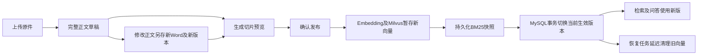

# 文档草稿、版本与发布接口

全部路径以 `/api/v1/knowledge` 开头，统一放在原来的 `app/routers/knowledge_router.py` 和Swagger“知识库”分组，不再单独注册“知识文档版本”分组。需要登录及 `knowledge:manage` 权限；文档创建者可管理自己的文档，admin角色或超级管理员可管理全部。请求沿用Bearer Token及统一响应，实际内容在 `data`。

## 推荐调用顺序



单份上传和人工预览均不写入Milvus；多份上传会自动完成预览与发布，成功文件直接可检索。正文每次保存生成一个新版本和新的Word文件，原件与来源版本保留。修改已有业务文档时，传同一个 `doc_id`；不要每次都创建新的业务文档，否则会被当成不同知识来源同时检索。

## 接口清单

| 方法和子路由 | 中文名称及用途 | 关键参数/返回 |
|---|---|---|
| POST `/docs/upload` | 单份保存草稿，多份逐份自动发布 | multipart：file为文件列表、整批共用一个category；title可选，默认各自文件名；doc_id可选；单份返回原详情，多份返回计数及items |
| GET `/docs` | 分页查询可管理文档，包括尚未发布的草稿 | page、page_size、category可选 |
| GET `/docs/{doc_id}/revisions` | 查询同一文档的全部版本 | offset、limit；返回版本列表及total |
| GET `/revisions/{revision_id}` | 查看版本完整正文和文件信息 | 返回body、来源版本、revision_no、version、status |
| GET `/docs/{doc_id}/editable` | **编辑页读取基线**：返回当前已发布且生效版本的正文 | 仅需doc_id；返回body、revision_no、title、category、published_at、base_version。无生效版本时404 |
| POST `/docs/{doc_id}/edit` | **推荐**：修改正文另存新草稿 | 仅需doc_id；JSON：body，title/category省略时沿用生效版本；不传revision_id与expected_version |
| POST `/revisions/{revision_id}/edit` | 已废弃（deprecated），仅兼容旧前端 | JSON：expected_version、title、category、body；不要再新增调用 |
| POST `/revisions/{revision_id}/preview` | 基于当前正文生成切片快照 | JSON：expected_version；返回chunks、chunk_count及递增后的version |
| GET `/revisions/{revision_id}/preview` | 分页查看已保存的切片预览 | offset、limit；返回preview_current、base_document_current |
| POST `/revisions/{revision_id}/publish` | 确认发布，切换检索中的当前内容 | JSON：expected_version，取最近一次预览返回的version |
| POST `/revisions/{revision_id}/restore` | 从历史正文生成新Word和新草稿 | JSON：expected_version；恢复后仍需预览及确认发布 |
| POST `/revisions/{revision_id}/discard` | 取消未发布草稿并归档留存 | JSON：expected_version；不影响当前已发布内容 |
| GET `/revisions/{revision_id}/file` | 下载版本文件或上传原件 | source=false为版本文件，source=true为来源原件 |

分类统一使用 `resume`（简历）、`job_description`（岗位说明）、`policy`（人才制度）、`training`（培训课件）、`assessment`（测评标准）、`case`（项目案例）、`development_plan`（培养方案）。仍按既有三个Milvus集合存取，岗位说明进入knowledge_chunks。

## Swagger多份上传

在同一个 `POST /api/v1/knowledge/docs/upload` 点击Try it out，file支持选择或添加多个文件，category只选一个合法分类（必填），然后Execute。multipart仍使用原字段名file，多份文件重复这个字段，旧客户端提交一份file也可继续使用。

一份文件保持原来的草稿响应；两份及以上自动解析、清洗、切片、向量化、保存BM25并发布，不需要人工调用预览与发布接口。服务内部复用同一版本流程，仍保留版本和预览快照。整批按同一category存取，不提供逐份分类参数，也不自动识别文件内容类别。

多份响应 `data` 示例：

```json
{
  "total": 2,
  "success_count": 1,
  "failed_count": 1,
  "category": "training",
  "items": [
    {"file_name": "培训制度.txt", "doc_id": 100, "revision_id": 201, "status": "published", "chunk_count": 3},
    {"file_name": "损坏文档.pdf", "doc_id": 101, "revision_id": 202, "status": "failed", "error": "文档解析失败，请检查文件格式、编码或是否加密"}
  ]
}
```

每份按独立事务处理，一份失败不会撤销已成功的文件，也不阻止后续文件。解析失败时保留通过上传校验的原件和failed版本，可下载原件、修正正文另存后预览发布，或修正文件后重新上传；空文件、超限或不支持格式在上传校验时拒绝，不保证有doc_id/revision_id。向量化、预览或发布失败时，已保存的原件和草稿保留，items.status为failed、revision_status为draft；使用返回的revision_id读取详情后重新预览发布。HTTP200表示整批处理结束，必须检查failed_count及各项status。

doc_id保持已有参数语义，没有增加批量禁止更新限制：不填时各文件各建业务文档；填写同一doc_id时逐份创建该文档的新版本并顺序发布，最后成功发布版本生效，前面成功版本保留为历史。title不填时每份取各自文件名；填写时整批使用此标题。整个请求同步处理，文件较多时应等待响应。

## 请求示例与并发约定

上传草稿返回如 `doc_id=100, revision_id=201, version=1`。修改正文时：

```json
{
  "expected_version": 1,
  "title": "培训报销制度",
  "category": "training",
  "body": "培训报销上限为3000元，请提交发票。"
}
```

上例是已废弃的按版本编辑写法。**新代码请用文档入口**：用户编辑的对象是文档，调用方不应去找版本ID。

### 按文档编辑（doc_id，推荐）

```json
{ "body": "培训报销上限调整为5000元，请提交发票。", "title": "培训报销制度" }
```

`POST /files/docs/88/edit` —— 只传 doc_id：

- **基线由后端决定**：取该文档「当前已发布且生效」的版本（`knowledge_revision_repository.published()`，行锁 + `populate_existing`），**不是**最新创建的版本，也**不是**未发布草稿。
- 保存为**新草稿**（`status='draft'`），`parent_revision_id` 指向该生效版本；生效版本本身一个字节都不改，仍需预览切片并确认发布才生效。
- 不传 `expected_version`，不存在"读了草稿却基于生效版本保存"的过期冲突；两个并发编辑各自拿到不冲突的 `revision_no`。
- 文档从未发布过任何版本时返回 404「该文档暂无已发布且生效的版本，请先上传并发布后再编辑」，不会退化成基于草稿修改。
- 编辑页回显用 `GET /files/docs/88/editable`，返回的就是同一份生效版本正文，所以"看到的内容"与"修改所基于的内容"永远一致。

预览、发布、恢复、取消仍按 `revision_id` 操作——那是新草稿产生之后的事，返回值里带 `revision_id`，不需要调用方自己查找。

`revision_no`是同一文档的业务版本序号；`version`是某条记录的乐观锁号。行锁负责串行分配revision_no与切换发布，乐观锁拒绝过期操作。正文、标题、分类或分块配置改变时，预览摘要不再匹配；其他版本抢先发布时，预览关联的文档version失效。此时返回409，应重新读取并预览，再由用户确认发布。接口同步等待处理完成，前端应展示处理中状态并设置足够的请求超时。

## 各层代码及职责

| 层 | 文件 | 核心职责 |
|---|---|---|
| 总路由 | app/routers/router.py | 注册版本子路由，沿用统一/api/v1前缀 |
| 子路由 | app/routers/knowledge_router.py | 知识库检索、草稿上传、正文版本、预览及发布接口，中文说明、鉴权、提交/回滚和下载 |
| 参数校验 | app/schemas/knowledge_revision.py | 编辑正文、合法分类、expected_version及长度限制 |
| 业务编排 | app/services/knowledge_revision_service.py | upload/edit/preview/publish/restore/discard、文件快照、事务与任务日志 |
| 仓库 | app/repositories/knowledge_revision_repository.py | 查询版本、锁定文档和版本、分配版本号及文件关联查询 |
| 数据模型 | app/models/knowledge_revision.py | 新表8条外键及同文档最多一个生效版本约束 |
| 文件复用 | app/services/file_service.py | 上传校验、对象存储及files元数据；biz_type=knowledge_revision、biz_id=doc_id |
| 解析复用 | app/ai/rag/document_loader.py | TXT、Word、PDF/OCR、Excel及图片解析，保留页码/工作表 |
| 清洗分块复用 | app/ai/rag/document_splitter.py | 复用现有清洗、重叠分块及语义分块逻辑 |
| 向量化复用 | app/ai/rag/embedding_service.py | 使用现有Embedding模型生成向量 |
| 向量存取复用 | app/adapters/vector_store/milvus_adapter.py | 七分类映射三个集合、精确切片白名单检索及精确删除 |
| 检索复用 | app/ai/rag/retriever.py | 权限及分类过滤、语义/BM25/混合召回、重排、附加版本引用 |
| BM25复用 | app/ai/rag/bm25_index.py | 发布时从本事务SQL切片重建并持久化快照；普通查询保留缓存/降级 |
| 补偿日志复用 | app/repositories/rag_ingest_job.py | 外部写入前持久化意图，以MySQL命名锁判定任务是否仍在运行 |
| 版本补偿 | app/services/knowledge_revision_recovery.py | 核对事务提交结果，精确清理旧/暂存向量及未提交对象 |
| 恢复调度复用 | app/services/rag_recovery.py、app/routers/knowledge_router.py | 扫描pending日志，定时恢复与重试 |

## 保存与发布的一致性

仅新增knowledge_revisions，原表不增删字段。files保存原件、新Word、完整正文JSON、预览JSON及索引清单；JSON复用受控上传服务，以.txt扩展名登记。knowledge_docs的id保持稳定，只在发布成功时更新当前标题、分类、文件和索引状态；knowledge_chunks只保存当前生效切片。历史切片内容在预览文件中，历史切片ID及集合/模型信息在索引清单中。

新向量先写入Milvus，检索先从MySQL取**当前切片主键白名单**再召回，因此未提交向量不会被检索，也不会挤掉旧版召回名额。向量、清单和BM25快照准备完成后，同一MySQL事务归档旧版并发布新版。任何步骤异常均回滚SQL，旧发布版继续生效；新资源留给持久化任务补偿。接口失败后先读取详情确认实际状态，避免在提交结果不确定时误判。

旧向量至少延迟60秒再清理；恢复worker每60秒扫描一次，故不保证60秒内完成。清理只删除日志中的精确切片ID，并排除当前仍生效的ID。MinIO或Milvus暂不可用则保留pending日志等待重试。

本机.env已启用 `RAG_DURABLE_INGEST_ENABLED=true`。部署也需启用此项，使恢复worker运行；也可在db312环境执行 `python -m scripts.recover_rag_jobs`。不要运行会清空业务表的测试fixture。

## 兼容入口与边界

`/knowledge/docs/upload` 保留原URL：单份返回doc_id、revision_id、version、body及status=draft，需手动预览发布；多份返回逐份自动发布结果。旧 `/files/upload` 隐藏于Swagger，并转接相同处理函数，返回契约同步变化，不触发旧的上传完成BM25回调。临时新增的 `/knowledge/drafts/upload` 及独立版本路由文件已移除，所有管理操作统一在“知识库”分组。检索继续使用 `/knowledge/retrieve`。`/ingestion/trigger` 保留已有文件的显式直接入库能力，供内部联调用；旧retry接口只用于历史失败文档，拒绝直接处理draft。

已有自动入库文档第一次上传新版本时，会补建首版历史快照。该首版正文由既有切片重建，可能含重叠内容，不能视为原件全文的精确还原；原件仍保留可下载。后续新上传均保存切片前完整正文。编辑生成的Word用于内容版本留存，不保证复刻原PDF/Excel版式；编辑后不伪造原页码。

版本权限沿用原文档归属和管理权限；检索权限沿用原文档public/dept/role规则。版本接口没有额外增加审批流或修改旧文档的访问范围。

## 验证

真实服务脚本：`python -m scripts.smoke_knowledge_revisions`。通过真实ASGI路由、JWT、MySQL、MinIO、Milvus和Embedding调用，覆盖上传草稿、正文另存Word、预览、过期version冲突、发布、混合检索、向量写入后故障回滚、补偿、重试、历史恢复、取消草稿、列表及匿名拒绝；脚本仅创建并清理本次测试数据，不创建或改变表结构。

离线契约：tests/test_knowledge_revisions.py；覆盖精确向量隔离、旧/暂存向量清理范围、预览失效、任务锁释放，以及回滚遗留BM25快照不可复用。真实联调结果保存在logs/revision_smoke.log。
