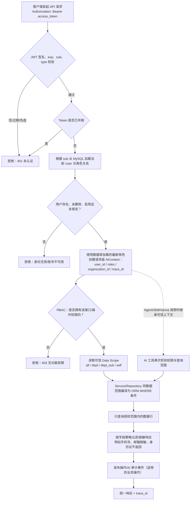
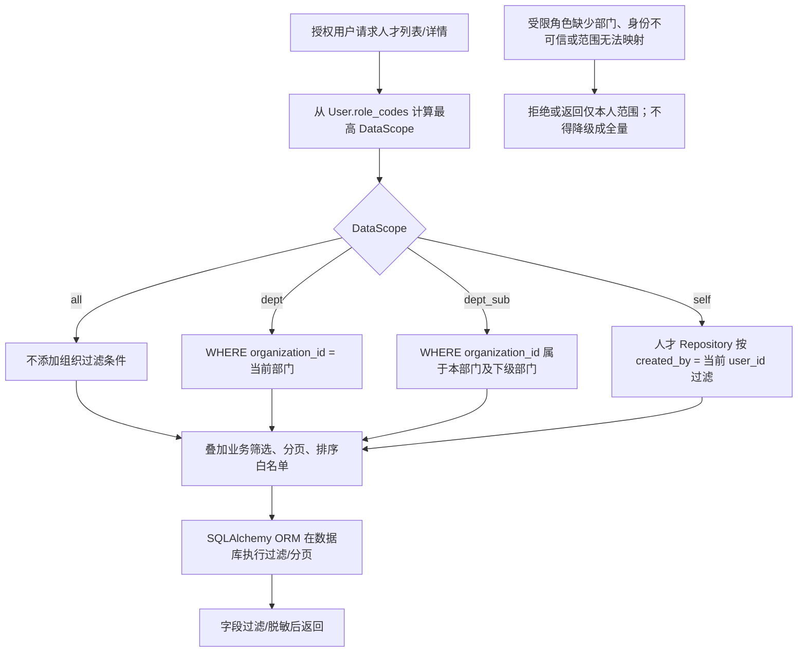

# AI 数字化人才平台权限控制架构与流程图

> 本文分清两类内容：**代码已核实实现**与**需求/验收目标**。核对范围为当前仓库的 `app/core/security.py`、`dependencies.py`、`permissions.py`、人才 Router/Service/Repository、`AIContext`、Skills、NL2SQL validator、AuditService 等。不是对生产环境、所有模块或所有外部服务的安全审计。

## 一、权限模型

平台权限不是“是否登录”一个判断，而是至少包括：

1. **身份认证 Authentication**：确认请求来自哪个有效用户。
2. **功能权限 Authorization / RBAC**：确认该用户能否调用接口、执行具体操作。
3. **数据权限 Data Scope**：确认用户可访问哪些行/部门/人才。
4. **字段权限 Field-level**：控制手机号、邮箱、身份证、薪资、测评报告等敏感字段。
5. **操作审计 Audit**：记录谁在何时对哪个对象执行了什么操作。

架构约束：业务 Router、Agent、RAG、Vanna、Dify 不应各自从请求体猜测用户身份；要由统一认证依赖建立可信上下文，再由对应 Service/Repository 执行授权过滤。

## 二、身份认证到业务数据的统一流程图



### 流程说明

- **JWT 只用于建立身份，不把 Token 中的角色声明作为最终授权依据。** 当前 Token 会携带 `sub`、`username`、`roles`、`type`、`iat`、`exp`、`jti`；`get_current_user()` 校验 Token/吊销状态后按 `sub` 重新加载用户，`require_permission()` 使用加载出的 `user.role_codes`，因此角色权限以数据库用户关系为准。
- **功能权限先于业务数据访问。** FastAPI 以 `Depends(require_permission(...))` 或 `require_roles(...)` 做统一接口依赖。前端隐藏按钮只改善体验，不构成安全边界。
- **行级范围必须下推到查询。** 只检查接口权限并不能代表可看所有人才；列表和详情查询均需要 Repository/Service 将可信范围变成数据库过滤条件，不能“先全量取出再在前端隐藏”。
- **AI 链路不得信任 LLM 的 `user_id` / `roles` 参数。** 当前认证依赖设置 `AIContext`，Skills 的 `required_permission` 从上下文角色检查；NL2SQL 的 `checked_scope()` 验证认证身份和 `analytics:read`，再注入数据范围。
- **审计是旁路，不应让审计落库失败阻断主业务。** 当前 `publish_audit` / EventBus / `AuditService` 提供脱敏与异步入库；是否覆盖所有读取、导出、修改操作需按业务点逐一核对。

## 三、数据范围控制流程图



| Data Scope | 意义 | 本项目代码枚举 | 当前人才模块对应行为 |
|---|---|---|---|
| ALL | 全部授权数据 | `all` | 不增加部门范围过滤 |
| DEPARTMENT | 本部门 | `dept` | `Talent.organization_id == 当前部门` |
| DEPARTMENT_AND_CHILD | 本部门及下级 | `dept_sub` | 按组织路径筛选本部门及下级 |
| SELF | 仅本人 | `self` | 当前 `TalentRepository.scope()` 以 `Talent.created_by == user_id` 作为本人数据口径 |
| CUSTOM | 自定义部门/业务范围 | 当前枚举未实现 | 需求建议能力，不能宣称已支持 |

**需要核验的本人数据口径**：当前人才列表的 SELF 基于 `created_by`，NL2SQL 对 `self` 因账号与人才档案映射尚未配置而拒绝问数。若业务定义“本人”是 `User.talent_id` 对应的人才，而非“由此用户创建的人才”，需统一修正规则并补用例。

## 四、RBAC 数据关系与接口权限

```text
users  ──< user_roles >── roles
                           │
                           └── role code → app/core/permissions.py 中的 ROLE_PERMISSIONS
                                                │
                                                └── require_permission("talent:read")
```

角色说明：`super_admin`、`admin`、`hr`、`manager`、`employee`。权限码按“模块:动作”组织，例如 `talent:read`、`talent:update`、`matching:review`、`analytics:read`。`require_permission()` 支持任一权限或全部权限；超级管理员有通配权限。

当前仓库的 RBAC 实现以代码常量 `ROLE_PERMISSIONS` / `ROLE_DATA_SCOPE` 为主，数据库模型包含 `roles`、`user_roles`，**尚未发现独立的 `sys_permission` / `role_permission` 动态权限表与后台配置闭环**。因此“角色—权限关系可配置管理”是后续扩展点，不应误说成目前已由数据库动态配置。

## 五、字段级控制、AI 模块与审计

### 字段级

人才档案 `TalentService.public_data()` 选择白名单字段输出：手机号按规则脱敏、邮箱脱敏、身份证不返回。这是当前可核实的字段保护实现。但尚不能据此断言全平台字段级策略已覆盖薪资、测评报告、所有导出及所有响应；应按敏感字段建立统一策略并做接口检查。真正不应读取的字段优先从查询列/投影层排除，而不是仅依赖前端隐藏。

### AI 与外部工具

- **Agent/Skill**：`get_current_user()` 把用户身份写入 `AIContext`；Skill 通过 `required_permission` 校验上下文角色，LLM 提交的身份参数不应覆盖可信上下文。
- **人才 RAG/语义检索**：人才 Service/Repository 使用 actor context 和受限回表；仍须逐项检查向量召回的过滤表达式与回表权限，不能只检查结果展示层。
- **Vanna/NL2SQL**：`sql_validator.checked_scope()` 检查 `analytics:read`、角色范围和部门归属；`inject_data_scope()` 对受限部门范围的已支持分析表注入过滤条件；`self` 目前拒绝执行，缺少可靠部门映射的分析表也拒绝执行，属于 fail-closed。只读、表白名单、SQL AST、LIMIT 等是额外防线。
- **Dify**：Dify API Key 是服务到服务凭证，不代表最终用户权限。平台仍应在业务接口通过统一用户认证/RBAC，并将平台用户范围作为可信上下文传给工作流；不得把 Dify Key 当作用户授权。
- **Redis**：可用于缓存/吊销状态等，但本次核对未发现“权限角色缓存 + 角色变更立即失效”这一完整缓存闭环；当前依赖重新加载用户角色，不能宣称 Redis 权限缓存已完成。

### 审计

`AuditService` 支持事件式发布、敏感字段值脱敏和 AuditLog 入库；审计查询 Router 需要 `audit:read`。写审计失败被捕获并记录日志，不阻断业务。验收时需验证具体业务修改、导出、AI 调用是否都发布事件，以及审计记录是否带操作者、目标对象、trace_id 和成功/失败结果。

## 六、代码位置（当前仓库核对）

| 能力 | 当前代码位置 |
|---|---|
| JWT 签发/验证、密码哈希 | `app/core/security.py` |
| 当前用户、权限依赖、角色依赖 | `app/core/dependencies.py` |
| Role/Permission/DataScope 规则函数 | `app/core/permissions.py` |
| 用户/角色关系 | `app/models/user.py`、`app/models/role.py`、`app/repositories/user_repository.py` |
| 人才可信身份与行级过滤 | `app/services/talent_access.py`、`app/services/talent_profile_service.py`、`app/repositories/talent_profile_repository.py` |
| AI 身份上下文与 Skill 权限 | `app/ai/context.py`、`app/ai/skills/base.py` |
| NL2SQL 范围和 SQL 校验 | `app/adapters/nl2sql/sql_validator.py`、`app/adapters/nl2sql/vanna_adapter.py` |
| 字段脱敏、审计事件 | `app/services/talent_profile_service.py`、`app/services/audit_service.py`、`app/routers/audit_router.py` |

## 七、当前实现核验结论

| 控制项 | 当前判断 | 说明 |
|---|---|---|
| JWT 身份认证与用户状态校验 | 已有实现 | 签名/过期/类型、吊销、用户存在/删除/启用/锁定检查 |
| 统一接口 RBAC | 已有实现 | Depends 权限工厂与角色工厂，业务接口可统一声明权限码 |
| ALL/DEPT/DEPT_SUB/SELF | 已有基础实现 | 纯函数计算 + 部分 Service/Repository 下推；需逐模块验证覆盖一致性 |
| CUSTOM 范围 | 未发现实现 | 需求/建议项 |
| 角色权限数据库动态配置 | 未发现完整实现 | 角色关系存在，权限映射主要在代码常量 |
| AI 上下文传递 | 已有实现 | `ContextVar` + `AIContext`，Skills/NL2SQL 有权限入口 |
| NL2SQL 行范围 | 部分已实现且 fail-closed | 支持表与部门范围有限；SELF/无映射时拒绝 |
| 字段级控制 | 部分实现 | 人才联系人输出脱敏；尚非全平台统一策略 |
| 操作审计 | 基础设施已实现、业务覆盖需核验 | EventBus/AuditService 有；不等于所有动作都已覆盖 |
| Redis 权限缓存即时失效 | 未发现完整实现 | 不应宣称已完成 |

## 八、权限模块 12 项验收清单

- [ ] 未登录、伪造、过期或已吊销 Token 访问受保护接口均拒绝（401 语义）。
- [ ] 禁用、锁定、逻辑删除用户无法继续访问。
- [ ] 已登录但没有接口权限时返回 403；权限点细分到读/写/复核/导出。
- [ ] HR / 部门主管 / 普通员工数据范围符合角色和组织关系。
- [ ] SELF 的业务含义在所有模块一致（本人关联人才还是本人创建的数据）。
- [ ] 详情、列表、统计、导出、批量操作都在查询/写入前验证范围。
- [ ] 敏感字段对不同角色正确过滤或脱敏，覆盖 API、报表和导出。
- [ ] RAG 在向量召回前做文档/组织权限过滤，并在回表时复核。
- [ ] Vanna 只读 SQL 有 AST/表白名单/行范围/LIMIT/超时验证；无可靠映射时拒绝。
- [ ] Agent/Skill 保留最终用户的可信身份，拒绝 LLM 自行传入身份覆盖。
- [ ] 角色授权变更后，数据库加载/任何缓存能及时反映撤权。
- [ ] 关键修改、复核、导出、AI 调用有审计记录并能按 trace_id 回查。

## 九、答辩表达建议

> 我们把权限拆成身份、功能、数据和字段四个控制面，再用审计形成闭环。当前代码已经有 JWT 当前用户依赖、RBAC 权限码、DataScope 函数和 ORM 行过滤，并把认证身份写入 AIContext；NL2SQL 对无法可靠限定范围的查询会拒绝，而不是放宽成全量。字段级策略和审计覆盖、动态角色配置及跨模块范围一致性仍需按验收清单完善，不能只凭需求文档说全部完成。
